# CancerLens — Architecture & API Contract (`ARCHITECTURE.md`)

- **Date:** November 2, 2026 (`America/Chicago`)
- **Status:** Authoritative Specification (Live `https://cancerinfo-api.onrender.com/` Callout + Meta Model API `$150` Pool + Baseten Claim Verification Layer `$100` Pool + `SG-01`–`SG-10` State Machine; Zero Custom GPU Containers; Zero Voice Input)

---

## 1. System Boundaries & Zero-Duplicate-Corpus Principle

1. **Client Layer (Option 2 Zero-Dependency Modern HTML5 / CSS3 / Vanilla JS in `frontend/`):**
   - Renders the interactive workspace centered on the **Two-Card Focal Lens Switcher** (`Mode A: Explore & Learn` $\leftrightarrow$ `Mode B: Verify & Evaluate`), unified search/claim bar, `Easy to Understand` / `Research & Provenance View` toggle, Inline Confirmation Drawer for screenshot OCR and public URL extraction (`IMAGE_OCR`, `URL_EXTRACT`), Clause 6 separated AI explanations vs. source facts/excerpts, 5D Context-Mismatch tables, Related Reviewed Claims panel, and `T1`–`T6` Telemetry Trace Drawer.
2. **Application & Orchestration Layer (`CancerLens` `FastAPI` Backend in `backend/`):**
   - Enforces the 6-stage state machine (`INPUT_PARSED` $\rightarrow$ `TOOL_REQUESTED` $\rightarrow$ `TOOL_EXECUTED` $\rightarrow$ `EVIDENCE_VALIDATED` $\rightarrow$ `ASSESSMENT_VALIDATED` $\rightarrow$ `DISPLAYABLE`) and all 10 safeguards (`SG-01`–`SG-10`).
   - Calls **`Cancer Info API`** live over HTTPS (`CANCER_INFO_API_BASE_URL=https://cancerinfo-api.onrender.com/`) via a single `CancerInfoAPIClient` (zero `FixtureCancerInfoAPIClient`).
   - Caches only non-restricted `Cancer Info API` responses in a **short-TTL in-memory RAM cache (`cachetools.TTLCache`, 5-minute TTL)** and **never stores a duplicate medical corpus database on disk**.
3. **Medical Knowledge & Rights Layer (`Cancer Info API` — `https://cancerinfo-api.onrender.com/`):**
   - Standalone service owning the 25-cancer target (20 common + 5 rare), WHO Licence `202610792` (granted Oct 23, 2026) and multi-source rights validation, structured facts, concise summaries, consensus facts, limited attributed quotations, original URLs, and provenance.
4. **Serverless AI Reasoning & Claim Verification Providers (Zero Custom GPU Containers):**
   - **Meta Model API (`$150` Pool — `POST https://api.meta.ai/v1/responses`, verified Oct 29, 2026):**
     - Verified Model ID: **`muse-spark-1.3`** (`store=false`, `reasoning={"effort": "low"}`).
     - Powers **Learn Mode** educational synthesis, multimodal screenshot text extraction (`IMAGE_OCR`), and cross-provider failover/comparison.
   - **Baseten Claim Verification Layer (`$100` Pool — `POST https://inference.baseten.co/v1/chat/completions`, verified Oct 30, 2026 in Tests `T1`–`T5`):**
     - Verified Model ID: **`meta-models/muse-spark-open-1026`** (`reasoning_effort="low"`, `max_tokens >= 1024`).
     - Powers **Evaluate Mode (Claim Verification Layer)**:
       1. Claim normalization & compound claim splitting into `1–5` atomic claims (`T2`/`T3`).
       2. Controlled tool-call generation (`search_admitted_evidence`) to query `Cancer Info API` ($\le 3$ bounded hops) while purging premature assistant prose on `tool_calls` (`T4` / `SG-02`).
       3. Grounded claim evaluation, 4-state verdict assignment, and 5D context-mismatch analysis over returned `Cancer Info API` evidence (`T5` / `SG-07`), plus 1-click Live Consistency Double-Checks.

---

## 2. Request Lifecycle & State Machine (`SG-01` to `SG-10`)

1. **Input & Mode Lock (`SG-06`):** Validate input size/format, block personal clinical advice or lesion images (`OUT_OF_SCOPE_CLINICAL`), and lock `resolved_mode` (`LEARN` or `EVALUATE`) from the user's Interactive Focal Lens Switch.
2. **Multimodal Confirmation Gate:** For screenshots (`IMAGE_OCR`) or public URLs (`URL_EXTRACT`), run extraction and return an editable draft (`POST /api/v1/extract/image` or `/api/v1/extract/url`) requiring explicit user confirmation before evaluation (voice input is out of scope per `D11`).
3. **Normalization & Claim Decomposition (`INPUT_PARSED`):**
   - **In `EVALUATE` Mode:** Call **Baseten (`meta-models/muse-spark-open-1026`)** (`reasoning_effort="low"`, `max_tokens=1024`, `response_format={"type": "json_schema", ...}`) to normalize the input, extract `cancer_topic`, and split compound statements into `1–5` atomic claims (`T2`/`T3`).
   - **In `LEARN` Mode:** Normalize topic/category parameters and expand lay phrases via verified `learned_query_mappings` (Mechanism A).
   - Strip any Markdown code fences (`SG-07`) and validate against strict Pydantic schemas.
4. **Live `Cancer Info API` Callout (`TOOL_REQUESTED` $\rightarrow$ `TOOL_EXECUTED`):**
   - Query `Cancer Info API` (`CancerInfoAPIClient.search_evidence()`) for structured facts, concise summaries, consensus facts, and allowed excerpts for the target cancer, subtype, and category.
   - Record explicit machine retrieval state (`SG-03`): `TOOL_NOT_EXECUTED`, `TOOL_FAILED`, `SEARCH_EXECUTED_NO_MATCHES`, or `SEARCH_EXECUTED_WITH_MATCHES`.
   - If `SEARCH_EXECUTED_NO_MATCHES`, return an honest `CORPUS_COVERAGE_GAP` (`INSUFFICIENT_EVIDENCE`) with official fallback URL — never `CONTRADICTED`.
5. **Bounded Claim Verification Loop & Pending-Tool Prose Purge (`SG-02`):**
   - **In `EVALUATE` Mode:** **Baseten (`meta-models/muse-spark-open-1026`)** can request up to `max_hops = 3` `search_admitted_evidence` tool calls against `Cancer Info API`.
   - **Critical Rule (`SG-02`):** Whenever `finish_reason == "tool_calls"` or `message.tool_calls` is present, **discard `message.content` immediately** so ungrounded model prose is never treated as a verdict.
   - Once evidence retrieval completes (`SEARCH_EXECUTED_WITH_MATCHES`), Baseten (`meta-models/muse-spark-open-1026`) evaluates each atomic claim strictly against the returned `Cancer Info API` records (where `ai_processing_allowed == True`) and outputs the structured verdict + 5D Context-Mismatch table.
   - **In `LEARN` Mode:** **Meta Model API (`muse-spark-1.3`, `store=false`)** synthesizes the plain-language explanation strictly separated from `Cancer Info API` structured facts and verbatim quotes.
6. **Stage 4 Deterministic Provenance & Quote Verification (`EVIDENCE_VALIDATED` $\rightarrow$ `ASSESSMENT_VALIDATED`, `SG-08`):**
   - Mechanically verify in Python that every cited `fact_id` / `document_id` was actually returned by `Cancer Info API` in that session, verify that any verbatim quote is an exact substring of `limited_verbatim_excerpt`, preserve `observed_source_date` / `retrieved_at_utc` / `reviewed_at_date` without fabrication, and attach mandatory WHO Clause 3/6 attribution and non-endorsement disclaimers.
   - Any ungrounded assertion or invalid citation triggers automatic downgrade to `INSUFFICIENT_EVIDENCE` or safe abstention.
7. **Experience Consolidation & Display (`DISPLAYABLE`):**
   - Record non-additive token usage in `budget_ledger` (`SG-05`), query `APPROVED` entries from `claim_memory_library` for Related Reviewed Claims, and return the verified `ResultEnvelope`.

---

## 3. End-to-End System Architecture Diagram

```mermaid
flowchart TD
    %% STEP 1: USER INPUT & INTERACTIVE LENS SWITCH
    subgraph Step1["1. User Input & Interactive Focal Lens Switch (Browser UI — frontend/)"]
        U_Input["User Sets Interactive Focal Lens Switch: EXPLORE/LEARN ↔ VERIFY/EVALUATE\n• Mode Locked in Request Payload (SG-06)\n• Modalities: Text (TEXT) | Screenshot ≤ 5MB (IMAGE_OCR) | Public URL (URL_EXTRACT)"]
        UI_Confirm["Mandatory Inline Confirmation Drawer\n(For Screenshot OCR or Extracted URL Text)\nUser Reviews, Edits & Clicks 'Confirm'"]
    end

    %% STEP 2: FASTAPI GUARD GATE
    subgraph Step2["2. CancerLens FastAPI Guard Gate & Budget Breaker (< 10ms)"]
        G_Budget["Dual-Pool Budget & Rate Gate\n• Meta Pool ($115 pre-sub / $150 total)\n• Baseten Pool ($65 pre-sub / $100 total)"]
        G_MediaSSRF["Clinical Boundary, Media & SSRF Guards\n• Block Personal Diagnosis / Treatment / Lesion Scans (OUT_OF_SCOPE_CLINICAL)\n• Image Magic-Bytes, ≤ 4096px, EXIF Strip | URL DNS-Pinning & Private-IP Block"]
        G_Extract["Multimodal Text Extraction (If Image / URL)\nReturns Editable Draft to UI Confirmation Drawer"]
    end

    %% STEP 3: MODE ROUTING & NORMALIZATION
    subgraph Step3["3. Stage 2: Normalization, Atomic Claim Splitting & Memory Lookup (State: INPUT_PARSED)"]
        ModeRoute{"Locked Lens Mode\n(SG-06)"}
        LearnNorm["LEARN Mode Query Prep\n• Normalize cancer_id, subtype_id, category_slug\n• Apply APPROVED learned_query_mappings (Mechanism A)"]
        BasetenDecomp["EVALUATE Mode — Baseten Claim Verification Layer (Step 1)\nPOST https://inference.baseten.co/v1/chat/completions\nmodel: meta-models/muse-spark-open-1026 (T2/T3)\n• reasoning_effort='low', max_tokens=1024, json_schema (SG-04)\n• Strip Markdown Fences & Extract 1-5 Atomic Claims (SG-07)"]
    end

    %% STEP 4: LIVE CANCER INFO API CALLOUT
    subgraph Step4["4. Single Live Callout to Cancer Info API (State: TOOL_REQUESTED -> TOOL_EXECUTED)"]
        TTLCache{"5-Min In-Memory\nRAM TTLCache Hit?"}
        CancerInfoAPI[("Live Cancer Info API\n(https://cancerinfo-api.onrender.com/)\n• Enforces WHO 202610792 & Source Rights Gates\n• Returns Structured Facts, Concise Summaries,\n  Consensus Facts, Short Excerpts & Provenance")]
        MatchCheck{"Retrieval Machine State\n(SG-03)"}
        GapState["State: SEARCH_EXECUTED_NO_MATCHES\nReturn Honest CORPUS_COVERAGE_GAP (INSUFFICIENT_EVIDENCE)\nwith Official Source Fallback URL (Never 'CONTRADICTED')"]
    end

    %% STEP 5: SYNTHESIS & CLAIM VERIFICATION LOOP
    subgraph Step5["5. Learn Synthesis (Meta API) vs. Bounded Claim Verification (Baseten API)"]
        LearnSynth["LEARN Mode Synthesis — Meta Model API ($150 Pool)\nPOST https://api.meta.ai/v1/responses (muse-spark-1.3)\n• store=false, reasoning={'effort':'low'} (WHO Clause 6 & SG-04)\n• Synthesizes Plain-Language Explanation Strictly Separated\n  from Source Facts & Quotes"]
        BasetenEvalLoop["EVALUATE Mode — Baseten Claim Verification Layer (Steps 2 & 3)\nPOST https://inference.baseten.co/v1/chat/completions\nmodel: meta-models/muse-spark-open-1026 (T4/T5)\n• Bounded ≤ 3 Hops via search_admitted_evidence tool calls\n• SG-02 (T4 Fix): Immediately PURGE message.content on finish_reason=='tool_calls'\n• On finish_reason=='stop': Strip Fences & Validate Schema (SG-07)\n• Produces 4-State Verdict + 5D Context-Mismatch Table"]
    end

    %% STEP 6: STAGE 4 DETERMINISTIC VERIFIER
    subgraph Step6["6. Stage 4: Deterministic Provenance, Quote & Clause 3/6 Verifier (State: ASSESSMENT_VALIDATED)"]
        Stage4Gate["Deterministic Python Stage-4 Verifier (SG-08)\n• Verify every cited fact_id/document_id came from Cancer Info API in this session\n• Verify verbatim quotes match limited_verbatim_excerpt exactly\n• Preserve observed_source_date / retrieved_at_utc / reviewed_at_date (never fabricate)\n• Enforce WHO Clause 3/6 Attribution & Non-Endorsement Labels\n• Downgrade any ungrounded assertion to INSUFFICIENT_EVIDENCE"]
        MemConsolidate["Stage 5: Operational Ledger & Reviewed Memory Lookup\n• Log non-additive token usage to budget_ledger (SG-05)\n• Fetch APPROVED Related Reviewed Claims from claim_memory_library"]
    end

    %% STEP 7: FINAL UI RENDER
    subgraph Step7["7. User Sees Verified Output (State: DISPLAYABLE)"]
        FinalUI["Interactive Focal Lens Workspace (frontend/)\n• Non-Binary Verdict Badges (Icon + Label + Border)\n• AI Plain-Language Explanation Clearly Separated from Source Facts (Clause 6)\n• Structured Facts & Limited Attributed Excerpts with Original WHO/NCI URLs\n• 3 Separated Dates (Observed Source / Retrieved / Reviewed)\n• 5D Context-Mismatch Matrix, Related Reviewed Claims & Pivot-in-Place Bridges\n• Redacted Meta ($150) & Baseten ($100) Telemetry Drawer"]
    end

    %% FLOW CONNECTIONS
    U_Input --> G_Budget
    G_Budget --> G_MediaSSRF
    G_MediaSSRF -->|"Image / URL"| G_Extract
    G_Extract --> UI_Confirm
    UI_Confirm -->|"User Confirmed Text"| ModeRoute
    G_MediaSSRF -->|"Direct Text"| ModeRoute
    ModeRoute -->|"LEARN"| LearnNorm
    LearnNorm --> TTLCache
    ModeRoute -->|"EVALUATE"| BasetenDecomp
    BasetenDecomp --> TTLCache
    TTLCache -->|"Miss"| CancerInfoAPI
    CancerInfoAPI --> MatchCheck
    TTLCache -->|"Hit"| MatchCheck
    MatchCheck -->|"SEARCH_EXECUTED_NO_MATCHES"| GapState
    GapState --> FinalUI
    MatchCheck -->|"SEARCH_EXECUTED_WITH_MATCHES - LEARN"| LearnSynth
    LearnSynth --> Stage4Gate
    MatchCheck -->|"SEARCH_EXECUTED_WITH_MATCHES - EVALUATE"| BasetenEvalLoop
    BasetenEvalLoop -->|"Needs Hop 2 or Hop 3 (Prose Purged per SG-02)"| TTLCache
    BasetenEvalLoop -->|"finish_reason == stop"| Stage4Gate
    Stage4Gate --> MemConsolidate
    MemConsolidate --> FinalUI
```

