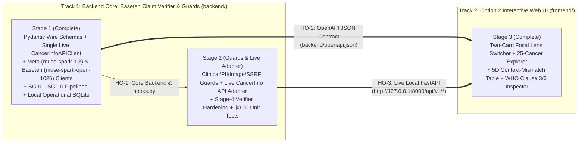

# CancerLens — Master Architecture & Staged Implementation Plan

**AI-Powered Cancer Information Discovery & Claim Evaluation Built on `Cancer Info API`, Meta Model API (`$150` Pool), and Baseten Claim Verification Layer (`$100` Pool)**

- **Date:** November 2, 2026 (`America/Chicago`)
- **Submission Deadline:** Wednesday, November 4, 2026 at 9:00 PM EST (8:00 PM CST)
- **Status:** Authoritative Clean-Slate Plan & Staged Multi-Agent Blueprint (Zero Custom GPU Containers; Zero Voice Input; Live `https://cancerinfo-api.onrender.com/`; 100% Aligned with Live Receipts & WHO Licence `202610792`)

---

## 1. System Vision & Clean 3-Layer Architecture

**CancerLens** is an independent, user-facing AI application for exploring trustworthy cancer information (**Learn Lens**) and evaluating cancer-related claims (**Evaluate Lens**).

**Single Source of Truth Rule:** CancerLens **never** stores a duplicate medical corpus database or uses fake/fixture API client classes. CancerLens consumes **`Cancer Info API`** live over HTTPS (`CANCER_INFO_API_BASE_URL=https://cancerinfo-api.onrender.com/`) via a single `CancerInfoAPIClient` with a 5-minute in-memory `TTLCache`.

| Architectural Layer | Owner / Runtime | Core Responsibility |
| :--- | :--- | :--- |
| **Layer 1: Curated Medical Information & Rights Layer (`Cancer Info API`)** | Live Standalone FastAPI Service (`https://cancerinfo-api.onrender.com/`) | • Discovers, structures, and normalizes cancer information across the **25-cancer target (20 common + 5 rare)**.<br>• Enforces source-level and document-level publication gates (including **WHO Licence `202610792`** granted Oct 23, 2026, NCI, and other cleared sources).<br>• Serves structured facts, concise summaries, consensus facts, limited attributed quotations, original URLs, and provenance.<br>• **Single source of truth for all medical content.** |
| **Layer 2: Topic Synthesis & Multimodal Layer (`Meta Model API` — `$150` Pool)** | Serverless `POST https://api.meta.ai/v1/responses` (Verified Model: **`muse-spark-1.3`**) | • Synthesizes **Learn Mode** plain-language explanations while strictly separating AI-generated text from source-attributed facts and verbatim excerpts (`"store": false`, `"reasoning": {"effort": "low"}`).<br>• Extracts text from informational screenshots (`IMAGE_OCR`) or SSRF-guarded public URLs (`URL_EXTRACT`) into a mandatory user-editable confirmation box (voice input is out of scope per `D11`).<br>• Provides cross-provider verification and failover. |
| **Layer 3: Claim Verification Layer (`Baseten Model API` — `$100` Pool)** | Serverless `POST https://inference.baseten.co/v1/chat/completions` (Verified Model: **`meta-models/muse-spark-open-1026`**) | • **Step 1 — Claim Normalization & Atomic Splitting (`T2`/`T3`):** Extracts `cancer_topic` and decomposes compound posts into `1–5` atomic claims (`reasoning_effort="low"`, `max_tokens=1024`, `response_format={"type": "json_schema", ...}`).<br>• **Step 2 — Controlled Evidence Search Tool Calls (`T4` + `SG-02`):** Generates `search_admitted_evidence` tool calls ($\le 3$ bounded hops) executed by the backend against `Cancer Info API` while immediately purging premature `message.content` during `tool_calls`.<br>• **Step 3 — Grounded Claim Evaluation & 5D Context-Mismatch Analysis (`T5` + `SG-07`):** Evaluates each atomic claim strictly against returned `Cancer Info API` records (`SUPPORTED`, `MIXED_OR_CONTEXT_DEPENDENT`, `CONTRADICTED`, `INSUFFICIENT_EVIDENCE`), plus 1-click Live Consistency Double-Checks. |

---

## 2. Authoritative Legal, Rights & WHO Licence (`202610792`) Controls

Per the **WHO Licensing & Integration Handoff (October 31, 2026)** and **Organizer Approval (`Oct 30, 2026`)**:

### 2.1 Confirmed WHO Permission Scope (`Request ID: 202610792`, Granted Oct 23, 2026)
- **Valid Grant (`CONFIRMED`):** Worldwide, royalty-free, non-exclusive, non-transferable, non-sublicensable licence to use selected WHO published materials in `Cancer Info API`.
- **Permitted Content Model (`CONFIRMED`):** Selected source metadata, structured factual information, concise paraphrased summaries, limited attributed quotations/excerpts, and direct links to original WHO URLs (not metadata-only, and never full-webpage mirroring or wholesale reproduction).
- **Coverage Scope (`CONFIRMED` + `PROJECT DECISION`):** Not limited to 4 cancer types (Breast, Lung, Colorectal, and Cervical were initial examples). `Cancer Info API` targets **20 common + 5 rare cancers**, combining qualifying, document-reviewed WHO pages with NCI and other separately rights-cleared sources.
- **Controlled Deployment Decision (`PROJECT DECISION`):** Connect `CancerLens` to `Cancer Info API` via `CANCER_INFO_API_BASE_URL` in a controlled environment; do not expose raw WHO-derived API responses publicly, do not publish on RapidAPI, and do not enable subscriptions, paid plans, or advertisements.

### 2.2 Mandatory Clause 3, 5, 6 & 7–9 Compliance Rules in CancerLens
1. **Zero Duplicate Medical Corpus Storage in CancerLens:**
   - CancerLens **never** stores a persistent copy of WHO or `Cancer Info API` medical documents on disk.
   - CancerLens calls `Cancer Info API` live on every request via a single `CancerInfoAPIClient` and caches only non-restricted, publication-cleared responses in **ephemeral in-memory RAM with a short TTL (`5 minutes`)**.
2. **Clause 6 AI Provider Data-Handling Gate (`store=false` & Source-Aware Transmission):**
   - Every external model request from CancerLens explicitly sets non-retention parameters (`"store": false` on Meta API `/v1/responses`) and never sends full WHO webpages.
   - CancerLens inspects the `ai_processing_allowed` flag returned by `Cancer Info API` before including any record in an external LLM prompt. If `ai_processing_allowed is False`, CancerLens displays `Cancer Info API`'s structured facts, concise summary, and original source link directly without sending that text to an external LLM.
3. **Strict Separation of AI-Generated Text vs. WHO / Source Attribution (Clauses 3, 5 & 6):**
   - **Never attribute AI-generated text to WHO.** All AI-synthesized explanations carry an explicit badge: `AI-Generated Plain-Language Summary — Authored by CancerLens AI`.
   - **Verbatim Excerpts & Structured Facts:** Rendered in a visually distinct inset card (`--font-serif` for verbatim quotes) with the exact bibliographical reference required by Clause 3, the original canonical URL, and the explicit disclaimer: *"Independently developed; not published, endorsed, or sponsored by the World Health Organization (WHO)."*
4. **No WHO Logo, No Endorsement, Zero Commercialization (Clauses 7–9):**
   - Never use the WHO emblem/logo. Never imply WHO endorsement or affiliation. Zero advertisements, sponsorships, or paid plans.
5. **Hackathon Submission & Demo Compliance (`COMP-01` & `COMP-02`):**
   - `CancerLens` is a 100% standalone repository containing only work built during the hackathon window (`Oct 27 – Nov 4, 2026`).
   - The 3-minute demo video opens (`0:00–0:08`) with a one-line statement disclosing that `Cancer Info API` was pre-existing and that `CancerLens` (its Interactive Focal Lens UI, Meta Muse Learn synthesizer, Baseten `muse-spark-open-1026` Claim Verification Layer, Deterministic Stage-4 Verifier, and Reviewed Experience Memory) was built during the hackathon week.

---

## 3. Mandatory Backend State-Machine Safeguards (`SG-01` to `SG-10`)

Derived directly from our live October 29 (`muse-spark-1.3`) and October 30 (`meta-models/muse-spark-open-1026` Tests `T1`–`T5`) evaluations:

| ID | Safeguard Name | Exact Technical Rule Enforced in `CancerLens` Backend |
| :--- | :--- | :--- |
| **`SG-01`** | **6-Stage Backend State Machine** | Every request transitions strictly through: `INPUT_PARSED` $\rightarrow$ `TOOL_REQUESTED` $\rightarrow$ `TOOL_EXECUTED` $\rightarrow$ `EVIDENCE_VALIDATED` $\rightarrow$ `ASSESSMENT_VALIDATED` $\rightarrow$ `DISPLAYABLE`. Model assertions never advance the state machine. |
| **`SG-02`** | **Pending-Tool Prose Purge (`T4` Fix)** | Whenever `finish_reason == "tool_calls"` or `message.tool_calls` is non-empty, backend code **immediately discards `message.content`** (never exposing it to the UI or treating it as a verdict). Fixes the `T4` defect where `meta-models/muse-spark-open-1026` hallucinated *"no passages returned"* before any API search ran. |
| **`SG-03`** | **4-State Retrieval Machine Enum** | `CancerInfoAPIClient` callouts return one of four explicit machine states: `TOOL_NOT_EXECUTED`, `TOOL_FAILED`, `SEARCH_EXECUTED_NO_MATCHES`, or `SEARCH_EXECUTED_WITH_MATCHES`. Zero matches maps deterministically to `INSUFFICIENT_EVIDENCE` (`CORPUS_COVERAGE_GAP`), **never** `CONTRADICTED`. |
| **`SG-04`** | **Reasoning Budget & Truncation Gate (`T1`/`T2` Fix)** | Always set `reasoning_effort="low"` (Baseten `/v1/chat/completions`) and `reasoning={"effort": "low"}` + `store=false` (Meta API `/v1/responses`), with `max_tokens >= 1024` (`2048` for multi-claim synthesis). Any final turn with `finish_reason == "length"` or empty content is caught as `IncompleteGenerationError`. |
| **`SG-05`** | **Non-Additive Reasoning Token Ledger (`T2` Fix)** | `reasoning_tokens` is already included inside `completion_tokens` (`output_tokens`). `budget_ledger` bills strictly on `input_tokens` + `output_tokens` and logs `reasoning_tokens_subset` separately for diagnostics. |
| **`SG-06`** | **User UI Mode Ownership (`T3` Fix)** | When the user sets the **Interactive Focal Lens Switch** (`LEARN` or `EVALUATE`), backend code locks `resolved_mode`. Model-inferred intent is advisory only on unscoped inputs, except when triggering `OUT_OF_SCOPE_CLINICAL` safety refusals. |
| **`SG-07`** | **Markdown Fence Stripper & Pydantic Gate (`T5` Fix)** | Strip ```` ```json ... ``` ```` code fences before `Pydantic.model_validate_json()`. Never assume `response_format` guarantees valid JSON without schema validation. |
| **`SG-08`** | **Deterministic Stage-4 Provenance & Quote Verifier** | Mechanically verifies in Python that every cited `fact_id` / `document_id` came from the actual `Cancer Info API` response for that request, verifies any verbatim quote via exact normalized substring match against `limited_verbatim_excerpt`, preserves source/retrieval/review dates without fabrication, and enforces WHO Clause 3/6 attribution. Any ungrounded claim or invalid citation is downgraded to `INSUFFICIENT_EVIDENCE`. |
| **`SG-09`** | **macOS TLS `certifi` & Startup Key Check** | All `httpx.AsyncClient` instances (to `Cancer Info API`, Meta API, and Baseten) use `ssl.create_default_context(cafile=certifi.where())` — **never** `verify=False`. Key validation strips whitespace and rejects empty/short/placeholder keys (like `"echo"`). |
| **`SG-10`** | **Privacy, Review Gate & Redacted Telemetry** | Never log API secrets, raw `reasoning_content`, or personal health narratives. Strip PII before indexing canonical claims in `claim_memory_library`, and require `review_status = 'APPROVED'` before surfacing shared claims or applying `learned_query_mappings`. |

---

## 4. End-to-End Application Flow Diagram (User Input $\rightarrow$ Verified Output)

```mermaid
flowchart TD
    %% STEP 1: USER INPUT & INTERACTIVE LENS SWITCH
    subgraph Step1["1. User Input & Interactive Focal Lens Switch (Browser UI — frontend/)"]
        U_Input["User Sets Interactive Focal Lens Switch: EXPLORE/LEARN ↔ VERIFY/EVALUATE\n• Mode Locked in Request Payload (SG-06)\n• Modalities: Text (TEXT) | Screenshot ≤ 5MB (IMAGE_OCR) | Public URL (URL_EXTRACT)"]
        UI_Confirm["Mandatory Inline Confirmation Drawer\n(For Screenshot OCR or Extracted URL Text)\nUser Reviews, Edits & Clicks 'Confirm'"]
    end

    %% STEP 2: FASTAPI GUARD GATE
    subgraph Step2["2. CancerLens FastAPI Guard Gate & Budget Breaker (< 10ms)"]
        G_Budget["Dual-Pool Budget & Rate Gate\n• Meta Pool ($115 pre-sub / $150 total)\n• Baseten Pool ($65 pre-sub / $100 total)"]
        G_MediaSSRF["Clinical Boundary, Media & SSRF Guards\n• Block Personal Diagnosis / Treatment / Lesion Scans (OUT_OF_SCOPE_CLINICAL)\n• Image Magic-Bytes, ≤ 4096px, EXIF Strip | URL DNS-Pinning & Private-IP Block"]
        G_Extract["Multimodal Text Extraction (If Image / URL)\nReturns Editable Draft to UI Confirmation Drawer"]
    end

    %% STEP 3: MODE ROUTING & NORMALIZATION
    subgraph Step3["3. Stage 2: Normalization, Atomic Claim Splitting & Memory Lookup (State: INPUT_PARSED)"]
        ModeRoute{"Locked Lens Mode\n(SG-06)"}
        LearnNorm["LEARN Mode Query Prep\n• Normalize cancer_id, subtype_id, category_slug\n• Apply APPROVED learned_query_mappings (Mechanism A)"]
        BasetenDecomp["EVALUATE Mode — Baseten Claim Verification Layer (Step 1)\nPOST https://inference.baseten.co/v1/chat/completions\nmodel: meta-models/muse-spark-open-1026 (T2/T3)\n• reasoning_effort='low', max_tokens=1024, json_schema (SG-04)\n• Strip Markdown Fences & Extract 1-5 Atomic Claims (SG-07)"]
    end

    %% STEP 4: LIVE CANCER INFO API CALLOUT
    subgraph Step4["4. Single Live Callout to Cancer Info API (State: TOOL_REQUESTED -> TOOL_EXECUTED)"]
        TTLCache{"5-Min In-Memory\nRAM TTLCache Hit?"}
        CancerInfoAPI[("Live Cancer Info API\n(https://cancerinfo-api.onrender.com/)\n• Enforces WHO 202610792 & Source Rights Gates\n• Returns Structured Facts, Concise Summaries,\n  Consensus Facts, Short Excerpts & Provenance")]
        MatchCheck{"Retrieval Machine State\n(SG-03)"}
        GapState["State: SEARCH_EXECUTED_NO_MATCHES\nReturn Honest CORPUS_COVERAGE_GAP (INSUFFICIENT_EVIDENCE)\nwith Official Source Fallback URL (Never 'CONTRADICTED')"]
    end

    %% STEP 5: SYNTHESIS & CLAIM VERIFICATION LOOP
    subgraph Step5["5. Learn Synthesis (Meta API) vs. Bounded Claim Verification (Baseten API)"]
        LearnSynth["LEARN Mode Synthesis — Meta Model API ($150 Pool)\nPOST https://api.meta.ai/v1/responses (muse-spark-1.3)\n• store=false, reasoning={'effort':'low'} (WHO Clause 6 & SG-04)\n• Synthesizes Plain-Language Explanation Strictly Separated\n  from Source Facts & Quotes"]
        BasetenEvalLoop["EVALUATE Mode — Baseten Claim Verification Layer (Steps 2 & 3)\n• POST https://inference.baseten.co/v1/chat/completions\n• model: meta-models/muse-spark-open-1026 (T4/T5)\n• Bounded ≤ 3 Hops via search_admitted_evidence tool calls\n• SG-02 (T4 Fix): Immediately PURGE message.content on finish_reason=='tool_calls'\n• On finish_reason=='stop': Strip Fences & Validate Schema (SG-07)\n• Produces 4-State Verdict + 5D Context-Mismatch Table"]
    end

    %% STEP 6: STAGE 4 DETERMINISTIC VERIFIER
    subgraph Step6["6. Stage 4: Deterministic Provenance, Quote & Clause 3/6 Verifier (State: ASSESSMENT_VALIDATED)"]
        Stage4Gate["Deterministic Python Stage-4 Verifier (SG-08)\n• Verify every cited fact_id/document_id came from Cancer Info API in this session\n• Verify verbatim quotes match limited_verbatim_excerpt exactly\n• Preserve observed_source_date / retrieved_at_utc / reviewed_at_date (never fabricate)\n• Enforce WHO Clause 3/6 Attribution & Non-Endorsement Labels\n• Downgrade any ungrounded assertion to INSUFFICIENT_EVIDENCE"]
        MemConsolidate["Stage 5: Operational Ledger & Reviewed Memory Lookup\n• Log non-additive token usage to budget_ledger (SG-05)\n• Fetch APPROVED Related Reviewed Claims from claim_memory_library"]
    end

    %% STEP 7: FINAL UI RENDER
    subgraph Step7["7. User Sees Verified Output (State: DISPLAYABLE)"]
        FinalUI["Interactive Focal Lens Workspace (frontend/)\n• Non-Binary Verdict Badges (Icon + Label + Border)\n• AI Plain-Language Explanation Clearly Separated from Source Facts (Clause 6)\n• Structured Facts & Limited Attributed Excerpts with Original WHO/NCI URLs\n• 3 Separated Dates (Observed Source / Retrieved / Reviewed)\n• 5D Context-Mismatch Matrix, Related Reviewed Claims & Pivot-in-Place Bridges\n• Redacted Meta ($150) & Baseten ($100) Telemetry Drawer"]
    end

    %% FLOW CONNECTIONS
    U_Input --> G_Budget
    G_Budget --> G_MediaSSRF
    G_MediaSSRF -->|"Image / URL"| G_Extract
    G_Extract --> UI_Confirm
    UI_Confirm -->|"User Confirmed Text"| ModeRoute
    G_MediaSSRF -->|"Direct Text"| ModeRoute
    ModeRoute -->|"LEARN"| LearnNorm
    LearnNorm --> TTLCache
    ModeRoute -->|"EVALUATE"| BasetenDecomp
    BasetenDecomp --> TTLCache
    TTLCache -->|"Miss"| CancerInfoAPI
    CancerInfoAPI --> MatchCheck
    TTLCache -->|"Hit"| MatchCheck
    MatchCheck -->|"SEARCH_EXECUTED_NO_MATCHES"| GapState
    GapState --> FinalUI
    MatchCheck -->|"SEARCH_EXECUTED_WITH_MATCHES - LEARN"| LearnSynth
    LearnSynth --> Stage4Gate
    MatchCheck -->|"SEARCH_EXECUTED_WITH_MATCHES - EVALUATE"| BasetenEvalLoop
    BasetenEvalLoop -->|"Needs Hop 2 or Hop 3 (Prose Purged per SG-02)"| TTLCache
    BasetenEvalLoop -->|"finish_reason == stop"| Stage4Gate
    Stage4Gate --> MemConsolidate
    MemConsolidate --> FinalUI
```



---

## 5. CancerLens Local State vs. `Cancer Info API` Remote State

Because **`Cancer Info API`** owns all medical documents, structured facts, consensus records, and source-rights validation, **CancerLens's local database (`cancerlens_app.db`) is ultra-lightweight and stores ZERO medical corpus documents**:

1. **Short-TTL In-Memory Cache (`cachetools.TTLCache`, `maxsize=256`, `ttl=300` seconds):**
   - Holds non-restricted responses returned by `Cancer Info API` in RAM for up to 5 minutes so multi-hop searches within a user session don't repeat identical network round-trips. Never persisted to disk.
2. **`claim_memory_library` & `claim_memory_fts` (`FR-07` Related Reviewed Claims):**
   - Stores PII-scrubbed, generalized canonical claims (`canonical_claim_text`), their verified outcome code, nuance warnings, `cancer_info_api_version_hash`, and `review_status` (`PENDING_REVIEW` | `APPROVED` | `REJECTED`). Only `APPROVED` rows are displayed in shared views.
3. **`learned_query_mappings` (`FR-08` Adaptive Experience Learning — Mechanism A):**
   - Stores verified lay-phrase-to-medical-query mappings (`"chemo brain"` $\rightarrow$ `"cancer-related cognitive impairment"`), gated by `review_status = 'APPROVED'`.
4. **`budget_ledger` (Dual-Pool Serverless Credit Governance):**
   - Tracks every call to **Meta Model API (`$150` pool)** and **Baseten Model API (`$100` pool)** with hard pre-submission circuit breakers (`$115` Meta / `$65` Baseten) so `$35` in each pool remains untouched for Nov 5–8 judging.
5. **`saved_results` (Private User Result Snapshots):**
   - Private-by-default (`is_public = 0`), capability-token protected result snapshots with 30-day expiry and immediate deletion support.

---

## 6. Zero-Waste "Verify-Once & Commit" Credit Discipline

To protect both the **`$150` Meta Model API pool** and **`$100` Baseten Model API pool** throughout development:

1. **100% Offline LLM State-Machine Unit Tests (`$0.00` Credits):**
   - All LLM state-machine tests (`T1`–`T5` edge cases), security guards, and schema checks run offline using mocked HTTP transports (`$0.00` spend), while medical content retrieval calls the single live `Cancer Info API` endpoint directly (`CANCER_INFO_API_BASE_URL`).
2. **Zero Idle Cost (100% Serverless Token Billing):**
   - Because both `https://api.meta.ai/v1/responses` (`muse-spark-1.3`) and `https://inference.baseten.co/v1/chat/completions` (`meta-models/muse-spark-open-1026`) are serverless token-billed endpoints, idle cost is **`$0.00/hr`**.
3. **Single-Shot Milestone Gate ("Verify & Commit"):**
   - We only execute `@pytest.mark.live_smoke` **once per completed milestone**, automatically recording the live response to `tests/fixtures/recorded_live/` so UI polish and E2E Playwright checks cost **`$0.00`**.

---

## 7. Staged Technical Implementation Plan, Track Boundaries & Multi-Agent Handoffs

### 7.1 Core Rules & Multi-Agent Team Locked
1. **Single Source of Truth (`Live Cancer Info API Callout Only`):**
   - There is **no `FixtureCancerInfoAPIClient`**. `CancerLens` implements **one** `CancerInfoAPIClient` (`backend/app/clients/cancerinfo_client.py`) that makes live HTTPS callouts to **`Cancer Info API`** (`https://cancerinfo-api.onrender.com/`) with a 5-minute in-memory `TTLCache`.
2. **Track Boundaries:**
   - **Track 1 — Backend Core, Baseten Claim Verification Layer, Guards & Verification (`backend/`)** $\rightarrow$
     - **Stage 1 (complete):** Core schemas, operational SQLite (`cancerlens_app.db`), `CancerInfoAPIClient`, `MetaMuseClient`, `BasetenClaimVerifierClient`, `Learn`/`Evaluate` pipelines, and baseline `hooks.py` (`run_stage4_verifier`, `check_clinical_boundary`, `sanitize_pii`).
     - **Stage 2 guards:** Expanded security guards (`image_upload_guard`, `ssrf_url_guard`, hardened PII/clinical boundary guards) and automated security/verifier regression tests.
     - **Stage 2 adapter and review:** `muse-spark-1.3` prompt/response auditing, live `Cancer Info API` (`https://cancerinfo-api.onrender.com/`) alignment, and Gate 1–8 evaluation review.
   - **Track 2 — Frontend Interactive Web App (`frontend/` — Option 2 Zero-Dependency Modern HTML5/CSS3/Vanilla JS)** $\rightarrow$
     - **Stage 3 (complete):** Two-card Mode Selector (`Mode A: Explore & Learn` vs. `Mode B: Verify & Evaluate`), unified search bar, `Easy to Understand` / `Research View` density toggle, 5D Context-Mismatch Matrix, Stage-4 Provenance Inspector, and `T1`–`T6` Trace Drawer (`frontend/index.html`, `frontend/css/styles.css`, `frontend/js/data.js`, `frontend/js/app.js`).



---

### 7.2 Explicit Handoff Table Between Stages

| Handoff ID | From $\rightarrow$ To | Exact Deliverable & Interface Contract | What the Receiving Agent Needs to Know |
| :--- | :--- | :--- | :--- |
| **`HO-1` (Backend Stage 1 $\rightarrow$ Stage 2)** | **Stage 1 $\rightarrow$ Stage 2 (`backend/`)** | `backend/app/schemas/`, `clients/cancerinfo_client.py`, `providers/{meta_client,baseten_client,governance}.py`, `investigator/`, `db/operational_store.py`, and `api/routes.py`. | Stage 1 already provided working baselines for `check_clinical_boundary`, `sanitize_pii`, and `run_stage4_verifier` in `backend/app/investigator/hooks.py`. Stage 2 hardens `guard_image_upload`, `guard_public_url`, and align `cancerinfo_client.py` with `https://cancerinfo-api.onrender.com/`. |
| **`HO-2` (Frontend Wire Contract)** | **Stage 1 (`backend/`) $\rightarrow$ Stage 3 (`frontend/`)** | `backend/openapi.json` exported via `python -m backend.scripts.export_openapi` (`snake_case` wire format). | `frontend/js/app.js` consumes the exact `snake_case` `InvestigationEnvelope` / `ResultEnvelope` fields defined in `backend/openapi.json`. |
| **`HO-3` (Backend $\rightarrow$ Frontend REST API)** | **Backend (`backend/`) $\rightarrow$ frontend (`frontend/`)** | FastAPI server running on `http://127.0.0.1:8000/api/v1/*` with CORS enabled. | Frontend (`frontend/js/app.js`) never calls Meta API, Baseten, or `Cancer Info API` directly. It only calls CancerLens FastAPI endpoints (`http://127.0.0.1:8000/api/v1/*`) and renders the returned envelope. |

---

### 7.3 Stage-by-Stage Technical Execution Plan

#### 🔹 STAGE 1 (Track 1A — Backend Core, Schemas, Single Live `CancerInfoAPIClient`, Baseten Claim Verification Client & Operational SQLite)
- **Owner:** Stage 1 backend build
- **Folder Scope:** `backend/app/schemas/`, `backend/app/db/`, `backend/app/clients/`, `backend/app/providers/`, `backend/app/investigator/`, `backend/app/api/`
- **Stage 1 scope:**
  1. **Strict Wire Schemas (`backend/app/schemas/envelope.py` & `enums.py`):**
     - `PipelineState` (`INPUT_PARSED` $\rightarrow$ `TOOL_REQUESTED` $\rightarrow$ `TOOL_EXECUTED` $\rightarrow$ `EVIDENCE_VALIDATED` $\rightarrow$ `ASSESSMENT_VALIDATED` $\rightarrow$ `DISPLAYABLE`) — **`SG-01`**
     - `RetrievalState` (`TOOL_NOT_EXECUTED`, `TOOL_FAILED`, `SEARCH_EXECUTED_NO_MATCHES`, `SEARCH_EXECUTED_WITH_MATCHES`) — **`SG-03`**
     - `OutcomeCode` (`SUPPORTED`, `MIXED_OR_CONTEXT_DEPENDENT`, `CONTRADICTED`, `INSUFFICIENT_EVIDENCE`, `OUT_OF_SCOPE_CLINICAL`)
     - `ResultEnvelope` with WHO Clause 3/6 attribution fields (`ai_plain_language_summary` strictly separated from `evidence_items[].structured_fact_or_summary` and `evidence_items[].limited_verbatim_excerpt`).
  2. **Lightweight Local Operational SQLite (`backend/app/db/operational_store.py`):**
     - Creates `cancerlens_app.db` containing **only** `claim_memory_library`, `claim_memory_fts`, `learned_query_mappings`, `saved_results`, and `budget_ledger` (enforcing `SG-05` non-additive `reasoning_tokens_subset`, `review_status` gates, and `$115` Meta / `$65` Baseten circuit breakers). **Zero medical corpus tables.**
  3. **Single Live `CancerInfoAPIClient` (`backend/app/clients/cancerinfo_client.py`):**
     - Connects directly to `CANCER_INFO_API_BASE_URL` via `httpx.AsyncClient(verify=ssl.create_default_context(cafile=certifi.where()))` with a 5-minute in-memory `TTLCache`. Zero fake/fixture client classes.
  4. **Serverless LLM Provider Adapters & Orchestrators (`meta_client.py`, `baseten_client.py`, `learn_pipeline.py`, `evaluate_investigator.py`):**
     - **`meta_client.py` (`MetaMuseClient`):** Calls `POST https://api.meta.ai/v1/responses` with `model="muse-spark-1.3"`, `"store": false` (WHO Clause 6), `"reasoning": {"effort": "low"}` (`SG-04`), parsing the verified `/v1/responses` `output[]` structure from `receipts/2026-10-29-live-meta-text-call.md`.
     - **`baseten_client.py` (`BasetenClaimVerifierClient`):** Calls `POST https://inference.baseten.co/v1/chat/completions` with `model="meta-models/muse-spark-open-1026"`, `"reasoning_effort": "low"`, `"max_tokens": 1024` (`2048` for multi-claim verification), enforcing **`SG-02` Pending-Tool Prose Purge** (wipes `message.content` whenever `finish_reason == "tool_calls"`), **`SG-04` truncation check**, **`SG-05` non-additive token accounting**, and **`SG-07` Markdown Fence Stripper** as verified in `receipts/2026-10-30-baseten-muse-spark-open-eval.md`.

---

#### 🔹 STAGE 2 (Track 1B — Backend Guards, Stage-4 Deterministic Verifier & Automated Tests)
- **Owner:** Stage 2 guards build
- **Folder Scope:** `backend/app/guards/`, `backend/app/verifiers/`, `tests/`
- **Stage 2 scope:**
  1. **Security & Boundary Guards (`backend/app/guards/`):**
     - `clinical_boundary.py` (blocks personal diagnosis, treatment dosing, and clinical skin-lesion/scan requests with `OUT_OF_SCOPE_CLINICAL`).
     - `pii_sanitizer.py` (strips names, emails, phones, MRNs, and first-person identifiers before `claim_memory_library` indexing).
     - `image_upload_guard.py` (`PNG`/`JPEG`/`WEBP` magic bytes, $\le 5\text{ MB}$, $\le 4096 \times 4096\text{ px}$, in-memory EXIF stripping, zero disk persistence).
     - `ssrf_url_guard.py` (`https://` port 443 only, DNS resolution + private/loopback/link-local IP block across redirects).
  2. **Deterministic Stage-4 Provenance & Quote Verifier (`backend/app/verifiers/stage4_verifier.py`, `SG-08`):**
     - Mechanically verifies in Python that every cited `fact_id` / `document_id` came from `Cancer Info API` in that session, verbatim quotes match `limited_verbatim_excerpt` via exact normalized substring check, dates (`observed_source_date`, `retrieved_at_utc`, `reviewed_at_date`) are preserved without fabrication, and WHO Clause 3/6 attribution + non-endorsement disclaimers are attached.
     - Downgrades any ungrounded assertion or invalid citation to `INSUFFICIENT_EVIDENCE`.
  3. **Zero-Cost Test Suite (`tests/`):**
     - Regression tests for `T1`–`T5` Baseten evaluation findings, SSRF/upload guards, review-status gates, and WHO Clause 6 separation rules (`$0.00` credit cost).

---

#### 🔹 STAGE 3 (Track 2 — Option 2 Zero-Dependency Interactive Frontend UI in `frontend/` — COMPLETE)
- **Owner:** Frontend build
- **Folder Scope:** `frontend/` (`index.html`, `css/styles.css`, `js/data.js`, `js/app.js`)
- **Creative UX Innovation — Two-Card Mode Selector & Interactive Focal Lens (Replacing Static Tabs):**
  1. **Side-by-Side Mode Selector Cards (`Mode A: Explore & Learn` vs. `Mode B: Verify & Evaluate`):**
     - Matches the `CancerInfo API` / `Cancer Compass` midnight-navy aesthetic (`#060b14` canvas, `#0b1220` surface cards, `#10b981` emerald Learn accent, `#38bdf8` sky Evaluate accent, plus Light Mode `#FAF9F5` toggle) and deterministically locks `resolved_mode` (`LEARN` vs. `EVALUATE`, `SG-06`).
  2. **"Pivot-in-Place" Cross-Mode Bridges:**
     - Clicking a reviewed Common Public Claim inside a `Learn` category card smoothly flips to `Mode B: Verify & Evaluate` with that claim's 5D Context-Mismatch Dossier.
     - Clicking **"Explore Underlying Biology in Learn Lens $\rightarrow$"** on any `Evaluate` verdict card flips back to `Mode A: Explore & Learn` pre-filtered to that cancer type, subtype, and category.
  3. **Provenance, Safety & Telemetry Controls:**
     - `Easy to Understand` / `Research & Provenance View` density toggle, Mandatory Editable Confirmation Drawer for `IMAGE_OCR` and `URL_EXTRACT` (`SG-01`), WHO Clause 3/6 visual separation of editorial serif verbatim quotes vs. sans-serif AI plain-language explanations, 3 separated dates, 1-Click Live Consistency Double-Check button, and `T1`–`T6` Trace Drawer.

---

#### 🔹 STAGE 4 (All Collaborators — Live E2E Integration, Single-Shot Smoke Gate & Demo Readiness)
- Connect `CANCER_INFO_API_BASE_URL` in `.env.local`, run single-shot live verification (`Verify-Once & Commit`), verify all 8 gates in `TESTING.md`, and record the 3-minute demo video with the mandatory opening pre-existing vs. new-work disclosure (`COMP-01` & `COMP-02`).
