<p align="center">
  
</p>

<p align="center">
  
  
  
  
  <a href="LICENSE"></a>
</p>

<h1 align="center">CancerLens</h1>
<p align="center"><strong>Understand cancer information. Assess claims with traceable sources.</strong></p>
<p align="center">Two modes. One evidence base. Zero invented citations.</p>

<p align="center">
  <a href="#features">Features</a> •
  <a href="#setup">Setup</a> •
  <a href="#testing-the-app">Testing</a> •
  <a href="#how-it-works">How it works</a> •
  <a href="#api">API</a> •
  <a href="#project-structure">Structure</a> •
  <a href="#documentation">Docs</a> •
  <a href="#scope">Scope</a> •
  <a href="#safety">Safety</a>
</p>

***

## Features

<table>
<tr><th>Learn</th><th>Evaluate</th></tr>
<tr>
<td>Browse cancer, subtype and category. Ask questions in plain words. Get explanations linked to admitted passages with dates and explicit gaps.</td>
<td>Paste a claim, confirm the exact text, split compound claims, compare supporting and challenging passages and get a bounded outcome with limits.</td>
</tr>
</table>

* **Bounded outcomes:** Supported, Contradicted, Mixed or context dependent, Insufficient evidence. No false confidence percentages.
* **Provenance first:** every citation carries its source, original URL, attribution and dates. Unknown dates stay null, never guessed.
* **Honest abstention:** missing evidence, rights or scope produces a labeled gap or refusal, never a fabricated citation.
* **Two providers, one contract:** Meta for Learn synthesis, Baseten for claim verification, both behind budget circuit breakers and a single live call switch.

## Setup

Prerequisites: Python 3.12+ and a modern browser. No API keys are needed to
run the test suite or the facts only demo.

```bash
# 1. Backend (FastAPI on http://127.0.0.1:8000)
cd backend
python3 -m venv .venv
.venv/bin/pip install -e ".[test]"
cp .env.example .env.local
.venv/bin/python -m pytest            # offline suite: 174 tests, $0.00
.venv/bin/python -m uvicorn app.main:app
```

```bash
# 2. Frontend (static app on http://localhost:5500)
cd frontend
python3 -m http.server 5500
```

Open http://localhost:5500 in your browser. The top bar pill shows whether
the UI reached the backend; without the backend it runs in UI Preview Mode on
bundled sample data.

## Testing the app

Follow this script end to end (about 10 minutes, $0.00 without model keys):

1. **Learn a topic.** In Mode A pick any cancer (try lung cancer) and a
   category. Expect a plain language overview with cited facts, each carrying
   its source, original URL and dates.
2. **Verify a claim.** In Mode B paste "Sugar causes breast cancer" and run
   verification. Expect a bounded outcome (Supported, Contradicted, Mixed or
   Insufficient evidence), per assertion verdicts and the 5D context table.
3. **Try screenshot OCR.** In Mode B choose Screenshot OCR and upload
   `assets/testing-images/ocr-test-1-green-smoothie-lungs.png`. Without model
   keys the upload passes safety checks and asks for manual text; with keys it
   transcribes the claims automatically. The answer key is in
   `assets/testing-images/README.md`.
4. **Check provenance.** Click any citation to open the original source, and
   use Share Results to export a PNG summary card.
5. **Check the budget.** Open http://127.0.0.1:8000/api/v1/health/budget to see
   the live call switch and per pool spend. It starts at $0.00.

To enable live AI synthesis and verification, add your Meta and Baseten API
keys plus Meta per token pricing to `backend/.env.local`, set
`LIVE_LLM_CALLS_ENABLED=true`, and restart the backend. Typical demo cost is
fractions of a cent per call, bounded by pre submission caps.

## How it works

1. Share a claim in your own words or paste text to verify
2. Confirm the exact wording before anything runs
3. CancerLens retrieves only rights admitted passages for that use
4. Each atomic assertion is compared with its context in view
5. You get the outcome, the passages, the dates and the limits

Details: [Architecture](ARCHITECTURE.md).

## API

Full contract: [backend/openapi.json](backend/openapi.json). Main routes:

| Method | Path | Purpose |
| ------ | ---- | ------- |
| GET | `/api/v1/cancers` | Cancer catalog |
| POST | `/api/v1/learn` | Plain language explanation with citations |
| GET | `/api/v1/learn/coverage` | Per-category data availability for one cancer |
| POST | `/api/v1/evaluate` | Claim verdict with 5D context comparison |
| POST | `/api/v1/evaluate/double-check` | Consistency recheck against the same facts |
| POST | `/api/v1/extract/url` | Guarded public URL text extraction |
| GET | `/api/v1/health/budget` | Live switch state and dual pool spend |

## Project structure

```
backend/    FastAPI service: API routes, investigators, guards,
            provider clients, operational SQLite store, offline tests
frontend/   Zero dependency web app: index.html, css/, js/
assets/     Brand artwork (hero, footer)
receipts/   Dated verification records for live calls and checks
salesforce/ Optional Lightning explorer for the Cancer Info API
```

## Documentation

Specs are the source of truth:

* [Master plan](CancerLens_Consolidated_Implementation_Plan.md): vision to tested demo
* [PRD](PRD.md): product boundary, modes and release priorities
* [Architecture](ARCHITECTURE.md): request flow, API contract, dual provider strategy
* [Database](DATABASE.md): one database, rights aware retrieval
* [Security](SECURITY.md): safety, privacy and rights controls
* [Design system](DESIGN_SYSTEM.md): calm evidence first interface
* [Testing](TESTING.md): verification gates and demo exit bar
* [Code style](CODE_STYLE.md): engineering conventions
* [Baseten guide](Baseten_Guide.md): claim verification layer reference

## Scope

**Current scope**

* Learn and Evaluate modes over the live Cancer Info API (search, cancers, by ID facts)
* Rights aware retrieval with explicit coverage gaps and safe refusals
* Saved results with live revalidation, consistency double checks, URL extraction
* 172 offline tests passing with live model calls off by default

**Future scope**

* Full live verification matrix across both modes and providers
* Consensus item coverage once the upstream API seeds consensus data
* Demo video and public launch polish

## Safety

> CancerLens gives general information only. It does not diagnose, triage symptoms, choose treatments, set doses, recommend paths or interpret clinical images.

If evidence or rights are missing, it abstains instead of inventing a citation or date.

## Contributing

1. Read the master plan and PRD first
2. Pick one open item and bring evidence
3. Propose small, reviewed changes with tests

<p align="center">
  
</p>

<p align="center"><strong>Fight back with evidence.</strong></p>
