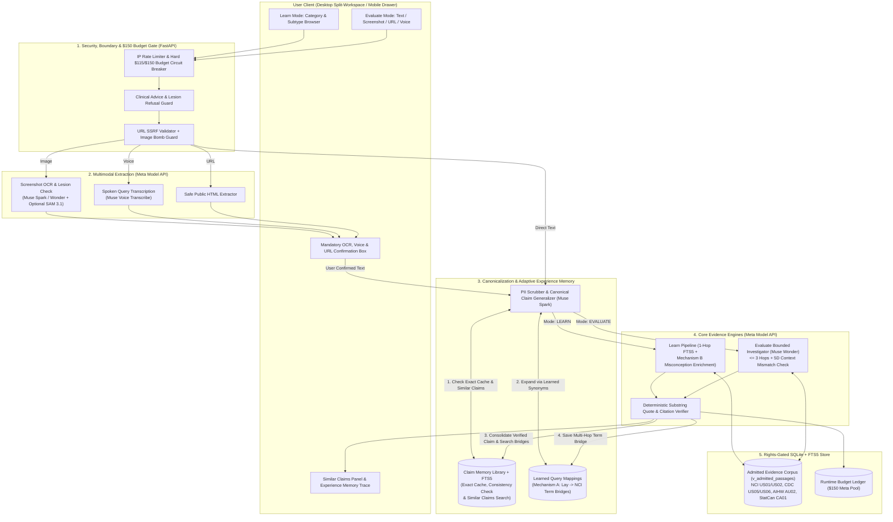

# CancerLens — System, Multi-Model & Adaptive Learning Architecture (`ARCHITECTURE.md`)

- **Document Status:** `PROPOSED` (Updated Specification Baseline v2 — Reflects Verified Participant Guide, `$150` Meta Model API Exclusive Pool, Similar Claims Library & Cache, and Adaptive Experience Learning)
- **Date:** October 28, 2026 (`America/Chicago`)
- **Authoring:** CancerLens team
- **Cross-References:** `PRD.md` (`FR-01`–`FR-19`), `DATABASE.md`, `SECURITY.md`, `CODE_STYLE.md`, `TESTING.md`

---

## 1. Purpose & Honest Architectural Classification

### 1.1 Purpose
`ARCHITECTURE.md` specifies the end-to-end technical architecture, stack selection, **Meta Model API** orchestration (`$150` exclusive pool), **Similar Claims Library & Exact-Match Cache/Double-Check (`FR-14`)**, **Adaptive Experience Learning (`FR-19` Mechanisms A & B)**, rights-enforced retrieval engine, post-generation citation/quote verification, API contracts, and Architecture Decision Records (ADRs) for **CancerLens**.

### 1.2 Honest Architectural Classification (`PROPOSED`)
Per the master brief and `Meta Hackathon Participant Guide.pdf` (Pages 4–5 & Page 11 *Best Agentic Use-Case*), we classify each mode honestly:
1. **Learn Mode (Category Browse & Guided Q&A) — Rights-Gated Structured RAG with Experience Enrichment:**
   - **What it is:** A deterministic, metadata-constrained Retrieval-Augmented Generation (RAG) workflow enhanced by **Adaptive Experience Memory (`FR-19`)**. Before running SQL + FTS5 BM25 retrieval (`WHERE admission_status = 'ADMITTED'`), it checks `learned_query_mappings` (**Mechanism A**) to expand lay phrasing into proven NCI medical terms, synthesizes a plain-language explanation via `Muse Spark` / `Muse Wonder`, runs a deterministic quote substring verifier, and appends verified **Common Claims & Clarifications** (**Mechanism B**) from `claim_memory_library`.
2. **Evaluate Mode (Compound Claim Assessment) — Bounded Evidence Investigator (`max_hops = 3`) with Self-Improving Search & Claim Memory:**
   - **What makes it a genuine Bounded Investigator (and eligible for *Best Agentic Use-Case*, Guide Page 11):**
     1. **PII Sanitization, Canonicalization & Exact-Match Memory Check:** Normalizes input into an anonymous `canonical_claim_text` and checks `claim_memory_library` against the current `corpus_snapshot_hash` for an instant `$0`-cost cache hit or live **Consistency Double-Check**.
     2. **Model-Controlled Decomposition & Tool Selection (`Muse Wonder` / `Muse Spark`):** Splits compound claims into atomic PICO assertions and selects specialized search tools (`search_passages_fts`, `lookup_cancer_statistics`, `lookup_nci_dictionary`, `check_evidence_lineage`).
     3. **Tool-Result Feedback & Autonomous Query Reformulation (`Hop 1 -> Hop 3`):** Inspects Hop 1 results for coverage gaps or PICO context mismatches and reformulates search queries up to `max_hops = 3` (hard code-enforced ceiling).
     4. **Experience Consolidation (Learning from Every Run):** Whenever Hop 2 or Hop 3 discovers a lexical bridge between a user's lay phrasing and an admitted NCI passage, the system persists that verified mapping into `learned_query_mappings` (**Mechanism A**) so future queries hit the optimal passage on **Hop 1**, and indexes the anonymized canonical claim into `claim_memory_library` to power the **Similar Claims** panel (`FR-14`) and cross-mode enrichment (**Mechanism B**).

---

## 2. Recommended Tech Stack & Solo-Developer Fallback (`PROPOSED`)

### 2.1 Primary Recommended Stack (FastAPI + Next.js + SQLite FTS5)
| Layer | Recommended Choice | Rationale for a First-Time API / Hackathon Builder |
| :--- | :--- | :--- |
| **Backend API & Orchestrator** | **Python 3.12 + FastAPI + Pydantic v2 + `httpx` (async)** | Cleanest way to make your first REST API calls to Meta Model API, enforce strict JSON schemas, and run automated `pytest` checks. |
| **Database, Search & Memory** | **SQLite 3.45+ with `FTS5` (BM25) + Strict Foreign Keys (`WAL` mode)** | Single-file, zero-cost database hosting the admitted corpus (`v_admitted_passages`), the `claim_memory_library` (`claim_memory_fts`), `learned_query_mappings`, and the `$150` `budget_ledger`. |
| **Frontend Web App** | **Next.js 15 (App Router, TypeScript) + Tailwind CSS** | Fast component assembly for the split-screen workspace, Similar Claims panel, and Experience Learning trace drawer. |
| **AI Runtime Provider** | **Meta Model API Exclusively (`$150` Credit Pool, Guide Page 1 & 5)** | Uses `Muse Spark` series, `Muse Wonder`, `Muse Voice Transcribe`, and optional `SAM 3.1` via one unified `MetaModelClient` class. Zero reliance on Baseten, Modal, or Fireworks partner credits. |
| **Deployment** | **Fly.io or Railway (Single Container w/ Persistent Volume) + Vercel** | Simple `git push` deployment with zero managed database fees. |

### 2.2 Low-Friction Fallback Stack
- **Single-Process Fallback (`DEC-02`):** If running two local servers (`FastAPI` on port `8000` + `Next.js` on port `3000`) feels complex, serve the UI directly from **FastAPI + Jinja2 + HTMX + Tailwind CSS** in one Python process.

---

## 3. High-Level System Architecture Diagram (`PROPOSED`)



---

## 4. Six-Stage Pipeline with Similar Claims & Adaptive Experience Learning (`PROPOSED`)

### Stage 0: Input Normalization & `$150` Budget Circuit Breaker (`< 5 ms`)
- Checks SQLite `budget_ledger`. Because Meta's Billing page "Spend Limit" is only a notification and requires an attached credit card (Guide Page 5), Python code enforces a **hard circuit breaker at `$115.00` pre-submission spend** (preserving `$35.00` for Nov 5–8 judging) and an **absolute hard stop at `$145.00`** so the `$150.00` credit grant is never exceeded.

### Stage 1: Multimodal Extraction & Mandatory User Confirmation (`Image`, `Voice`, `URL`)
- **Screenshot Upload (`POST /api/v1/extract/image`):** Validates `PNG`/`JPEG`/`WEBP` magic bytes, $\le 5\text{ MB}$, $\le 4096 \times 4096\text{ px}$, strips EXIF in memory. Calls `Muse Spark` / `Muse Wonder` vision endpoint to: (a) refuse clinical skin lesions, scans, or lab reports (`is_clinical_personal_image = True`), and (b) extract visible claim text into the **Editable Confirmation Box**.
- **Voice Query (`POST /api/v1/extract/voice`):** Accepts short audio (`\le 30\text{s}`), transcribes via **Muse Voice Transcribe** (Guide Page 1), and places the transcript into the **Editable Confirmation Box**.
- **Public URL (`POST /api/v1/extract/url`):** Enforces DNS-pinning SSRF block against private/loopback/metadata IPs, fetches up to `1 MB` HTML, strips scripts/boilerplate, and returns candidate claims to the **Editable Confirmation Box**.

### Stage 2: PII Sanitization, Intent Classification & Canonical Claim Cache Lookup (`Muse Spark`)
1. **Deterministic + Model PII Sanitization:** Strips emails, phone numbers, MRNs, person names, and first-person anecdotes, producing an anonymous `canonical_claim_text` (e.g., converting *"My uncle in Texas heard soursop tea cures prostate cancer"* $\rightarrow$ *"Soursop tea cures prostate cancer in humans"*).
2. **Boundary Guard:** If the input requests personal diagnosis or drug dosing (`OUT_OF_SCOPE_CLINICAL`), halts immediately, **never** writes to `claim_memory_library`, and returns safe educational category links.
3. **Exact-Match Claim Library Lookup (`FR-14`):**
   - Computes `canonical_claim_hash = sha256(normalize(canonical_claim_text))`.
   - Queries `claim_memory_library` where `canonical_claim_hash = :hash AND corpus_snapshot_hash = :current_corpus_hash`.
   - **If Hit & `force_live_rerun == False`:** Increments `search_hit_count`, retrieves top 4 **Similar Claims** via `claim_memory_fts`, and returns the verified `ResultEnvelope` in `< 50 ms` at **`$0.00` API cost** with `cache_status = "EXACT_CACHE_HIT"`.
   - **If Hit & `force_live_rerun == True`:** Continues to Stage 3 and compares the new live verdict against the stored verdict (`consistency_check_status = "MATCHED_STORED_VERDICT"` or `"UPDATED_WITH_DIFF"`).

### Stage 2.5: Mechanism A — Adaptive Query & Synonym Expansion (`learned_query_mappings`)
- Before executing FTS5 retrieval in either **Learn** or **Evaluate** mode, the pipeline checks `learned_query_mappings` for any previously learned lay-to-medical search bridges matching the input tokens (e.g., `"chemo brain"` $\rightarrow$ `"cognitive problems fatigue D125 D139"`, or `"baking soda"` $\rightarrow$ `"sodium bicarbonate complementary alternative medicine"`).
- Appends matched canonical NCI search terms directly into **Hop 1**, allowing the system to retrieve the exact target passages on the very first hop.

### Stage 3A: Learn Mode Execution + Mechanism B Cross-Mode Misconception Enrichment
1. Executes 1-hop rights-gated FTS5 + metadata query (`v_admitted_passages`).
2. Synthesizes plain-language explanation with `[doc_id:passage_id]` citations via `Muse Spark`.
3. **Mechanism B Enrichment (`FR-19`):** Queries `claim_memory_library` for verified claims matching `(cancer_id, category_slug)` and attaches up to 3 relevant community-checked claims + outcomes in `common_claims_in_category[]`.

### Stage 3B: Evaluate Mode Bounded Investigator (`Muse Wonder` / `Muse Spark`, `max_hops = 3`)
1. Decomposes compound claims into $1\dots 4$ atomic sub-claims.
2. Runs Hop 1 retrieval (augmented by Stage 2.5 learned mappings).
3. If any sub-claim lacks sufficient passages, `Muse Wonder` formulates revised Hop 2 / Hop 3 queries (broadening synonyms or checking parent cancer sections).
4. Evaluates each sub-claim against the 4-state rubric (`SUPPORTED`, `MIXED_OR_CONTEXT_DEPENDENT`, `CONTRADICTED`, `INSUFFICIENT_EVIDENCE`) and populates the 5-dimension `context_mismatches[]` array.

### Stage 4: Deterministic Post-Generation Quote & Citation Verifier
- Python verifies every `[doc_id:passage_id]` against `v_admitted_passages`, checks that every `verbatim_quote` is an exact normalized substring of `clean_text`, and injects nullable `observed_source_date` directly from SQLite.

### Stage 5: Experience Consolidation & Similar Claims Matching (`FR-14` & `FR-19`)
1. **Safety Gate Before Learning:** Only executes if `resolved_mode == 'EVALUATE'`, `boundary_refusal is None`, and Stage 4 verification passed with `0` invalid citations.
2. **Mechanism A Write (`learned_query_mappings`):** If Hop 2 or Hop 3 succeeded where Hop 1 returned 0 passages, records `(raw_query_phrase, successful_fts_query, cancer_id, category_slug, verified_passage_ids_json)` into `learned_query_mappings`.
3. **Claim Memory Library Upsert (`claim_memory_library`):** Inserts or updates the PII-scrubbed `canonical_claim_text`, its verdict summary, cited `document_ids`, and `corpus_snapshot_hash` into `claim_memory_library` and `claim_memory_fts`.
4. **Similar Claims Retrieval (`similar_claims_searched[]`):** Queries `claim_memory_fts` (excluding the current `canonical_claim_hash`) filtered by `cancer_id` / BM25 similarity to return top 4 similar claims searched in the application, complete with their verdict badges and nuance notes.

---

## 5. Meta Model API Strategy (`$150` Exclusive Pool — Guide Pages 1, 5, 9–12)

### 5.1 Strategic Alignment with Hackathon Tracks & Bonus Prizes (`VERIFIED` Guide Pages 9–12)
Because Baseten, Modal, and Fireworks partner credits are excluded, $100\%$ of runtime inference executes through the **Meta Model API** (`$150` credit pool):
- **Indie Developer Track (`$400,000` Pool, Pages 9–10):** Judged on `Impact (30%)`, `Use of Meta AI Tooling (25%)`, `Technical Depth & Execution (20%)`, and `Demo (25%)`.
- **Best Agentic Use-Case (`$5,000` Bonus, Page 11):** Directly targeted by our **3-Hop Bounded Investigator + Adaptive Experience Memory (`FR-19`)**.
- **Best Creative Build (`$5,000` Bonus, Pages 11–12):** Specifically rewards projects built using **Muse Wonder** or **Muse Image**. Using **Muse Wonder** as our core Investigator & Context-Mismatch reasoner qualifies CancerLens directly for this bonus track without violating medical integrity rules!

### 5.2 Updated Candidate Model Matrix (100% Meta Model API)
| Role ID & Pipeline Stage | Meta Model API Candidate (Guide Page 1) | Verification Gate (`VG-M2`) | Required Capability | Defensible Role in CancerLens | Simpler Alternative | Est. Calls & Tokens / Session | Assumed Cost Formula (`ASSUMED`) | Target Latency | Fallback Within Meta API | Scope Status |
| :--- | :--- | :--- | :--- | :--- | :--- | :--- | :--- | :--- | :--- | :--- |
| **`ROLE-1`: Intent Router, PII Sanitizer & Claim Decomposer** | **Muse Spark** (Meta Model API) | Verify exact `muse-spark*` slug on Meta Model List (Guide p. 6). | Fast structured JSON, PII stripping, canonical claim normalization, compound splitting. | Low-latency front door (`< 400ms`) that powers Stage 2 canonicalization, safety refusal, and sub-claim splitting. | Regex + single monolithic call. | `1 call` (`~700 in / 300 out` tokens) | `$0.50 / 1M in`, `$1.50 / 1M out` (`~$0.0008 / call`) | `300–500 ms` | Secondary `Muse Spark` tier. | **MVP Core (`P0`)** |
| **`ROLE-2`: Bounded Evidence Investigator & Mismatch Synthesizer** | **Muse Wonder** (Meta Model API) | Verify `muse-wonder*` slug and tool-call / JSON schema support in `M2`. | Deep multi-hop PICO reasoning, preclinical vs. human context mismatch detection, adaptive query reformulation. | Core analytical brain for Evaluate mode (`\le 3` hops) + qualifies project for *Best Agentic Use-Case* & *Best Creative Build* (Guide p. 11–12). | `Muse Spark` (used in `CONFIG-CORE` or after `$90` threshold). | `1–3 calls` (`~3,500 in / 900 out` tokens) or `0 calls` on Claim Cache Hit! | `$2.00 / 1M in`, `$6.00 / 1M out` (`~$0.012 / uncached session`) | `1.5–4.0 s` | `Muse Spark` 1–2 hop synthesis. | **MVP Core (`P0`)** |
| **`ROLE-3`: Informational Screenshot OCR & Lesion Refusal** | **Muse Spark Vision** / **Muse Wonder Vision** (Meta Model API) | Verify multimodal image payload format in `M2`. | High-accuracy OCR on social screenshots + visual refusal of skin lesions/scans. | Extracts claim text from screenshots while enforcing the Page 5 rule against skin blemish detectors. | Reject image and prompt text paste. | `1 call` on image upload (`~1,200 in / 300 out` tokens) | `$1.00 / 1M in`, `$3.00 / 1M out` (`~$0.002 / image`) | `1.2–2.5 s` | Prompt user to paste text. | **MVP (`P1`)** |
| **`ROLE-4`: Spoken Query Transcription** | **Muse Voice Transcribe** (Meta Model API) | Verify audio endpoint in `M2`. | Medical-term speech-to-text (`\le 30\text{s}` clips). | Accessibility input for fatigued users; feeds directly into Confirmation Box + Similar Claims pipeline. | Browser Web Speech API (`$0` cost). | `1 call` per voice input | `~$0.005 / clip` | `600–1,200 ms` | Browser Web Speech API. | **MVP / `P1`** |
| **`ROLE-5`: Cluttered Screenshot Text-Card Isolation** | **SAM 3.1** (Meta Model API) | Test in `M7` whether OCR on multi-column screenshots improves with `SAM 3.1` bounding boxes. | Bounding-box isolation of text regions inside noisy screenshots. | **Strictly Non-Clinical:** Never touches skin lesions or medical scans; only crops text cards from cluttered screenshots if needed. | Client-side canvas crop (`$0` cost). | `0–1 call` on cluttered screenshot | `~$0.002 / image` | `700 ms` | Direct Vision OCR (`SC-02`). | **Conditional (`P2`)** |
| **`ROLE-6`: Generative Imagery** | **Muse Image** | N/A — Excluded. | Image generation. | **Excluded:** Generated medical visuals are not scientific evidence. | Structured HTML tables. | `0 calls` | `$0.00` | N/A | N/A | **Excluded** |
| **`ROLE-7`: Development Coding Agent** | **Dev-time coding agent** (Guide Page 1 & 6) | Check recipe docs in `M1`. | Code generation & test authoring during build. | Accelerates solo developer implementation alongside the core team. | Standard IDE tools. | Dev-time only (`0` runtime calls) | Confirm if dev tool bills against `$150` pool. | N/A | Local IDE. | **Dev-Time Only** |

---

## 6. Updated `ResultEnvelope` Contract (With `similar_claims_searched` & `experience_learning`)

```json
{
  "request_id": "req_01jc9z2k8m4p7q2w5v",
  "schema_version": "2026-10-28.v2",
  "created_at_utc": "2026-10-30T19:14:22Z",
  "interpreted_input": {
    "source_modality": "IMAGE_SCREENSHOT",
    "raw_extracted_text": "Annual pancreatic CT scans save everyone over 40 from pancreatic cancer!",
    "user_confirmed_text": "Annual pancreatic CT scans save everyone over 40 from pancreatic cancer.",
    "canonical_claim_text": "Routine annual CT screening reduces pancreatic cancer mortality in average-risk adults over age 40.",
    "canonical_claim_hash": "8f3c91d2a4b5e6f70123456789abcdef0123456789abcdef0123456789abcdef",
    "pii_scrubbed": true,
    "detected_intent": "EVALUATE_CLAIM"
  },
  "resolved_mode": "EVALUATE",
  "cache_and_consistency_status": {
    "cache_status": "LIVE_EVALUATION_STORED",
    "consistency_double_check": "VERIFIED_CONSISTENT_WITH_CORPUS",
    "corpus_snapshot_hash": "a94f26a07fd2abcd5f99",
    "times_searched_in_app": 1
  },
  "experience_learning_applied": {
    "mechanism_a_synonym_bridges_used": [
      {
        "lay_phrase": "CT scan screening",
        "mapped_nci_terms": "screening tests imaging computed tomography mortality general population",
        "saved_hops": 1
      }
    ],
    "mechanism_a_new_bridges_learned": 1,
    "mechanism_b_enrichment_count": 2
  },
  "cancer_context": {
    "cancer_id": "pancreatic_cancer",
    "cancer_name": "Pancreatic cancer",
    "subtype_id": "pancreatic_exocrine",
    "category_slug": "screening",
    "jurisdiction_code": "US"
  },
  "coverage_status": "ADMITTED_PARTIAL",
  "plain_language_summary": "Admitted National Cancer Institute evidence contradicts the claim that routine annual CT screening reduces pancreatic cancer deaths in average-risk adults over 40 [D080:P01]. Surveillance is only studied for individuals at very high inherited or familial risk [D080:P02].",
  "claim_assessments": [
    {
      "subclaim_id": "sc_1",
      "extracted_assertion": "Routine annual CT scans reduce mortality from pancreatic cancer in average-risk adults over age 40.",
      "outcome_code": "CONTRADICTED",
      "outcome_label": "Contradicted by Admitted Evidence",
      "rationale": "NCI screening evidence states that screening tests for pancreatic cancer have not been shown to reduce the risk of dying from the disease in the general population [D080:P01].",
      "context_mismatches": [
        {
          "dimension": "POPULATION_RISK_STRATUM",
          "claim_context": "General / average-risk adults over age 40",
          "evidence_context": "High-risk individuals with inherited genetic syndromes (e.g., BRCA2, Peutz-Jeghers) or familial pancreatic cancer",
          "explanation": "Surveillance imaging (EUS or MRI) is discussed only for high-risk cohorts, not routine CT screening for the general public."
        }
      ],
      "supporting_passage_ids": [],
      "challenging_passage_ids": ["D080:P01", "D080:P02"],
      "independent_origin_count": 1
    }
  ],
  "similar_claims_searched": [
    {
      "claim_memory_id": "cm_0192d8f1",
      "canonical_claim_text": "Endoscopic ultrasound or MRI surveillance is studied for individuals with strong familial pancreatic cancer or inherited BRCA2 mutations.",
      "primary_outcome_code": "MIXED_OR_CONTEXT_DEPENDENT",
      "outcome_label": "Context-Dependent / High-Risk Only",
      "nuance_warning": "Applies strictly to high-risk genetic/familial cohorts, unlike general-population CT screening.",
      "cited_document_ids": ["D080"],
      "search_hit_count": 5
    },
    {
      "claim_memory_id": "cm_0192d8f2",
      "canonical_claim_text": "Routine CA 19-9 blood testing effectively screens asymptomatic average-risk adults for early pancreatic cancer.",
      "primary_outcome_code": "CONTRADICTED",
      "outcome_label": "Contradicted by Admitted Evidence",
      "nuance_warning": "CA 19-9 is used in monitoring diagnosed patients, not as a proven general-population screening test.",
      "cited_document_ids": ["D080", "D121"],
      "search_hit_count": 3
    }
  ],
  "evidence_passages": [
    {
      "passage_id": "D080:P01",
      "document_id": "D080",
      "origin_source_id": "US01",
      "organization": "National Cancer Institute (NCI)",
      "source_title": "Screening | Pancreatic Cancer - NCI",
      "canonical_url": "https://www.cancer.gov/types/pancreatic/screening",
      "section_locator": "Introductory Summary / General Population Screening",
      "is_verbatim_quote": true,
      "verbatim_quote": "There is no standard or routine screening test for pancreatic cancer. Screening tests have not been shown to reduce the risk of dying from pancreatic cancer in the general population.",
      "paraphrase_summary": "Routine screening tests are not recommended for the general public because they have not been shown to lower pancreatic cancer mortality.",
      "observed_source_date": "2026-08-03",
      "retrieved_at": "2026-10-28T14:20:00Z",
      "reviewed_at": "2026-10-16",
      "license_attribution": "National Cancer Institute (Cancer.gov). Text reused under NCI Copyright and Reuse Policy; adapted context labeled; third-party graphics excluded."
    }
  ],
  "limitations_and_gaps": [
    "Screening guidelines reflect US National Cancer Institute (US01) summaries reviewed August 3, 2026.",
    "Similar claims shown above have distinct target populations; never assume one claim's verdict applies to a differently worded claim."
  ],
  "model_trace": {
    "configuration": "CONFIG-EXPANDED",
    "investigator_hops_used": 1,
    "total_latency_ms": 2120,
    "total_estimated_cost_usd": 0.0112
  }
}
```

---

## 7. Updated Architecture Decision Records (ADRs)

- **`ADR-01` (SQLite + FTS5 for Corpus, Claim Memory & Synonym Learning):** Use SQLite `3.45+` `STRICT` tables + two `FTS5` virtual tables (`passages_fts` for medical evidence and `claim_memory_fts` for Similar Claims search).
- **`ADR-02` (100% Meta Model API Execution):** Disregard Baseten/Modal/Fireworks partner endpoints; route all inference (`Muse Spark`, `Muse Wonder`, `Muse Voice Transcribe`, `SAM 3.1`) through the `$150` Meta Model API credit pool with a hard in-code circuit breaker at `$115.00` pre-submission (`$35.00` Judge Reserve).
- **`ADR-03` (Sanitized Canonical Claim Memory & Exact-Match Cache — `FR-14`):** Strip PII and generalize user claims into anonymous `canonical_claim_text` before storing in `claim_memory_library`. Serve exact matches at `$0.00` credit cost when `corpus_snapshot_hash` matches, while allowing a 1-click Live Re-Run & Consistency Double-Check.
- **`ADR-04` (Safe Adaptive Experience Learning — `FR-19` Mechanisms A & B):** Never learn medical facts from user text. Instead, learn **verified search bridges (`learned_query_mappings`)** that map lay phrases to admitted NCI passages (cutting future multi-hop latency to 1 hop), and enrich both Learn and Evaluate responses with verified **Common Claims & Clarifications** from `claim_memory_library`.
