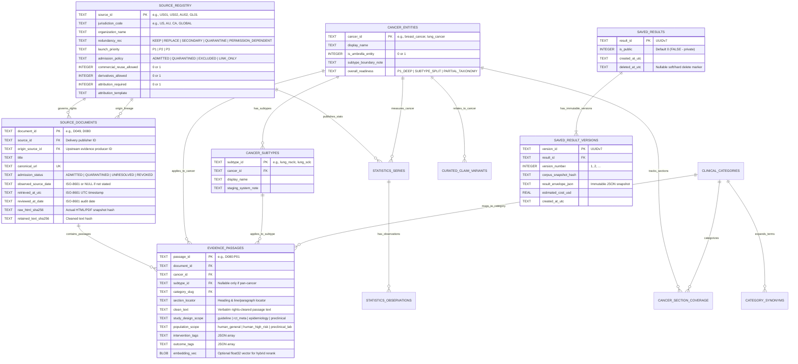

# CancerLens — Database Schema, Rights Provenance & Retrieval Specification (`DATABASE.md`)

- **Document Status:** `PROPOSED` (Specification Baseline — No Database Created Yet)
- **Date:** October 27, 2026 (`America/Chicago`)
- **Authoring:** CancerLens team
- **Cross-References:** `PRD.md` (`FR-01`–`FR-16`), `ARCHITECTURE.md` (`ADR-01`, `ADR-03`), `SECURITY.md` (`SEC-06`, `SEC-09`)

---

## 1. Purpose & Verified vs. Proposed Structure Distinction

### 1.1 Purpose
`DATABASE.md` specifies the relational schema, full-text search indexes (`FTS5`), rights-admission constraints, evidence lineage tracking, statistical metadata tables, versioned user result storage, and revocation/withdrawal cascades for **CancerLens**.

### 1.2Verified Pre-Existing Structures vs. Proposed CancerLens Schema
Per the master brief, we strictly distinguish verified artifacts from proposed database structures:
1. **`VERIFIED` Pre-Existing Workbook Structures (`CancerLens_Launch_Coverage_and_Permissions_2026-10-16.xlsx`):**
   - `Source register` (`A8:Z110`): 102 source records with columns `Source ID`, `Jurisdiction / country`, `Organization`, `Redundancy recommendation` (`Keep`, `Replace`, `Secondary`, `Quarantine`, `Permission-dependent`), `Launch priority` (`P1`–`P3`), licensing flags, and `Review date` (`2026-10-15`).
   - `Cancer readiness` (`A5:G31`): 26 cancer candidates with subtype boundary notes (`G6:G31`).
   - `Section coverage` (`A5:M343`): 338 rows mapping `(Cancer, Section, Requirement)` to `Finding` (`119 Source verified`, `168 Partial`, `51 Gap`), `Document IDs`, `Exact candidate URLs`, `Evidence locator`, `Rights basis`, and `Publication status` (`"Not accepted for publication by this audit"`).
   - `Document evidence` (`A5:J175`): 170 rows (`D001`–`D170`) with `Observed source date` (many explicitly `"Not observed in retrieved extract"`) and `Extract SHA256` labeled `"Research-tool transcript hash; not original HTML/PDF hash"`.
2. **`UNVERIFIED` Legacy `CancerInfo` Python Models (`Repository evidence!A10`):**
   - The workbook lists `app/models/__init__.py` (`bf41059ce30c3796f8c87762fa13298e6d3fb51c`), which is **not present** in our current clean workspace and lacked a publication rights gate (`Launch gaps!A8`).
3. **`PROPOSED` CancerLens SQLite Schema (Defined Below):**
   - A clean-room **SQLite 3.45+ (`WAL` mode, `PRAGMA foreign_keys = ON`)** relational + `FTS5` schema designed specifically to remediate every gap identified in `Launch gaps!A6:E16`.

---

## 2. Database Engine Rationale (`ADR-01`)

1. **Why SQLite 3.45+ with `FTS5`:**
   - **Enforced Rights Gate at the Storage Layer:** Every retrieval query joins `evidence_passages` with `source_documents` and `source_registry` using a mandatory SQL view (`v_admitted_passages`) that enforces `admission_status = 'ADMITTED'` and `revoked_at IS NULL`.
   - **Sub-10ms Lexical + Metadata Filtering:** Built-in `FTS5` provides BM25 ranking with custom column weights (`title`, `section_heading`, `clean_text`, `synonyms`) while relational joins filter strictly by `cancer_id`, `subtype_id`, `category_slug`, and `jurisdiction_code`.
   - **Zero-Cost, Single-File Reproducibility:** The entire admitted corpus, audit trail, and schema ship as a deterministic migration + seed pipeline (`data/cancerlens.db`), eliminating cloud database cold-starts or connection drops during hackathon judging.

---

## 3. Proposed Entity-Relationship Diagram (`PROPOSED`)



---

## 4. Complete Table Definitions, Constraints & Units (`PROPOSED`)

### 4.1 Pragmas & Initialization
```sql
PRAGMA journal_mode = WAL;
PRAGMA synchronous = NORMAL;
PRAGMA foreign_keys = ON;
PRAGMA busy_timeout = 5000;
```

### 4.2 `source_registry` (Maps `Source register!A8:Z110`)
Enforces organization- and product-level licensing rules outside the LLM.
```sql
CREATE TABLE source_registry (
    source_id TEXT PRIMARY KEY CHECK (length(source_id) BETWEEN 3 AND 16), -- e.g., 'US01', 'AU02', 'GL01'
    jurisdiction_code TEXT NOT NULL,                                        -- e.g., 'US', 'UK-ENG', 'CA', 'AU', 'GLOBAL'
    organization_name TEXT NOT NULL,
    site_name TEXT NOT NULL,
    canonical_base_url TEXT NOT NULL,
    redundancy_recommendation TEXT NOT NULL CHECK (
        redundancy_recommendation IN ('Keep', 'Replace', 'Secondary', 'Quarantine', 'Permission-dependent')
    ),
    launch_priority TEXT NOT NULL CHECK (launch_priority IN ('P1', 'P2', 'P3')),
    admission_policy TEXT NOT NULL CHECK (
        admission_policy IN ('ADMITTED', 'QUARANTINED', 'EXCLUDED', 'LINK_ONLY')
    ),
    commercial_reuse_allowed INTEGER NOT NULL DEFAULT 0 CHECK (commercial_reuse_allowed IN (0, 1)),
    derivatives_allowed INTEGER NOT NULL DEFAULT 0 CHECK (derivatives_allowed IN (0, 1)),
    attribution_required INTEGER NOT NULL DEFAULT 1 CHECK (attribution_required IN (0, 1)),
    permission_required INTEGER NOT NULL DEFAULT 1 CHECK (permission_required IN (0, 1)),
    attribution_template TEXT NOT NULL,
    third_party_caveats TEXT NOT NULL,
    official_policy_url TEXT NOT NULL,
    audit_review_date TEXT NOT NULL,                                        -- ISO-8601 date e.g. '2026-10-15'
    updated_at_utc TEXT NOT NULL DEFAULT (strftime('%Y-%m-%dT%H:%M:%SZ', 'now'))
) STRICT;
```

### 4.3 `cancer_entities`, `cancer_subtypes` & `clinical_categories` (Maps `Cancer readiness!A5:G31`)
```sql
CREATE TABLE cancer_entities (
    cancer_id TEXT PRIMARY KEY,                                             -- slug e.g. 'breast_cancer', 'lung_cancer'
    display_name TEXT NOT NULL UNIQUE,                                      -- e.g. 'Breast cancer', 'Lung cancer'
    in_legacy_seed_taxonomy INTEGER NOT NULL DEFAULT 0 CHECK (in_legacy_seed_taxonomy IN (0, 1)),
    is_umbrella_entity INTEGER NOT NULL DEFAULT 0 CHECK (is_umbrella_entity IN (0, 1)),
    subtype_boundary_note TEXT NOT NULL,                                    -- e.g. 'Include NSCLC and SCLC; no shared staging assumption.'
    launch_tier TEXT NOT NULL CHECK (launch_tier IN ('P1_DEEP', 'P1_SUBTYPE_SPLIT', 'TAXONOMY_GAP_HONEST')),
    created_at_utc TEXT NOT NULL DEFAULT (strftime('%Y-%m-%dT%H:%M:%SZ', 'now'))
) STRICT;

CREATE TABLE cancer_subtypes (
    subtype_id TEXT PRIMARY KEY,                                            -- e.g. 'lung_nsclc', 'lung_sclc', 'colorectal_colon'
    cancer_id TEXT NOT NULL REFERENCES cancer_entities(cancer_id) ON DELETE RESTRICT,
    display_name TEXT NOT NULL,
    clinical_distinction_note TEXT NOT NULL,
    UNIQUE (cancer_id, display_name)
) STRICT;

CREATE TABLE clinical_categories (
    category_slug TEXT PRIMARY KEY,                                         -- 'overview', 'symptoms', 'risk_factors', 'diagnosis', 'staging', 'treatment', 'screening', 'prevention', 'supportive_care', 'side_effects', 'prognosis', 'survival', 'follow_up', 'terminology'
    display_name TEXT NOT NULL,
    requirement_tier TEXT NOT NULL CHECK (requirement_tier IN ('Core', 'Conditional', 'Reference')),
    display_order INTEGER NOT NULL
) STRICT;

CREATE TABLE category_synonyms (
    synonym_id INTEGER PRIMARY KEY AUTOINCREMENT,
    category_slug TEXT REFERENCES clinical_categories(category_slug) ON DELETE CASCADE,
    cancer_id TEXT REFERENCES cancer_entities(cancer_id) ON DELETE CASCADE,
    lay_term TEXT NOT NULL,                                                 -- e.g., 'chemo brain', 'tumor stage', 'early detection'
    canonical_medical_term TEXT NOT NULL                                    -- e.g., 'cognitive problems', 'staging', 'screening'
) STRICT;
```

### 4.4 `source_documents` (Maps `Document evidence!A5:J175` with Truthful Dates & Lineage)
> [!IMPORTANT]
> `observed_source_date` is **nullable** (`TEXT`). A SQL trigger prevents inserting `retrieved_at_utc` into `observed_source_date` unless explicitly verified on the source page (`Launch gaps!A9`). `origin_source_id` tracks the original producer of the evidence so a republished page (`Cancer Australia D136` citing `NCI`) is never counted as a second independent source (`Launch gaps!A11`).

```sql
CREATE TABLE source_documents (
    document_id TEXT PRIMARY KEY,                                           -- e.g., 'D049', 'D080'
    source_id TEXT NOT NULL REFERENCES source_registry(source_id) ON DELETE RESTRICT,
    origin_source_id TEXT NOT NULL REFERENCES source_registry(source_id) ON DELETE RESTRICT,
    title TEXT NOT NULL,
    canonical_url TEXT NOT NULL UNIQUE,
    requested_url TEXT NOT NULL,
    admission_status TEXT NOT NULL DEFAULT 'UNRESOLVED' CHECK (
        admission_status IN ('ADMITTED', 'QUARANTINED', 'UNRESOLVED', 'REVOKED')
    ),
    admission_reason TEXT NOT NULL,
    observed_source_date TEXT,                                              -- NULL when source page does not state an update/publish date
    observed_date_raw_note TEXT,                                            -- Raw string if ambiguous; never fabricated
    retrieved_at_utc TEXT NOT NULL,                                         -- Exact UTC timestamp when HTML/text was fetched
    reviewed_at_date TEXT NOT NULL,                                         -- Date of rights & section audit (e.g. '2026-10-16')
    workbook_extract_sha256 TEXT,                                           -- Legacy research-tool transcript hash from workbook Col H (for audit trace only)
    raw_snapshot_sha256 TEXT,                                               -- SHA-256 of actual fetched HTML/CSV bytes (Required when ADMITTED)
    retained_text_sha256 TEXT,                                              -- SHA-256 of cleaned, graphics-stripped text (Required when ADMITTED)
    license_attribution_text TEXT NOT NULL,
    revoked_at_utc TEXT,
    revocation_reason TEXT,
    CHECK (
        admission_status != 'ADMITTED'
        OR (raw_snapshot_sha256 IS NOT NULL AND retained_text_sha256 IS NOT NULL AND revoked_at_utc IS NULL)
    )
) STRICT;
```

### 4.5 `cancer_section_coverage` (Maps `Section coverage!A5:M343`)
```sql
CREATE TABLE cancer_section_coverage (
    coverage_id TEXT PRIMARY KEY,                                           -- e.g. 'breast_cancer:screening'
    cancer_id TEXT NOT NULL REFERENCES cancer_entities(cancer_id) ON DELETE CASCADE,
    category_slug TEXT NOT NULL REFERENCES clinical_categories(category_slug) ON DELETE CASCADE,
    requirement_type TEXT NOT NULL CHECK (requirement_type IN ('Core', 'Conditional')),
    audit_finding TEXT NOT NULL CHECK (audit_finding IN ('Source verified', 'Partial', 'Gap')),
    runtime_coverage_status TEXT NOT NULL CHECK (
        runtime_coverage_status IN ('ADMITTED_COMPLETE', 'ADMITTED_PARTIAL', 'CORPUS_GAP', 'REVIEWED_NOT_APPLICABLE')
    ),
    primary_document_ids_json TEXT NOT NULL DEFAULT '[]',                   -- JSON array of document_ids e.g. '["D049"]'
    fallback_official_url TEXT,                                             -- Direct NCI URL to show user when status is CORPUS_GAP
    gap_or_scope_explanation TEXT NOT NULL,
    reviewed_at_date TEXT NOT NULL,
    UNIQUE (cancer_id, category_slug)
) STRICT;
```

### 4.6 `evidence_passages` & `passages_fts` (With PICO & Preclinical Metadata)
```sql
CREATE TABLE evidence_passages (
    passage_id TEXT PRIMARY KEY,                                            -- e.g. 'D080:P01'
    document_id TEXT NOT NULL REFERENCES source_documents(document_id) ON DELETE CASCADE,
    cancer_id TEXT REFERENCES cancer_entities(cancer_id) ON DELETE RESTRICT,
    subtype_id TEXT REFERENCES cancer_subtypes(subtype_id) ON DELETE RESTRICT,
    category_slug TEXT NOT NULL REFERENCES clinical_categories(category_slug) ON DELETE RESTRICT,
    section_heading TEXT NOT NULL,
    section_locator TEXT NOT NULL,                                          -- e.g. 'L38' or 'Section: General Population Screening, Para 1'
    clean_text TEXT NOT NULL CHECK (length(clean_text) >= 20),
    clean_text_normalized TEXT NOT NULL,                                    -- Lowercased, single-spaced text for deterministic substring verification
    char_length INTEGER NOT NULL,
    study_design_scope TEXT NOT NULL CHECK (
        study_design_scope IN (
            'clinical_guideline_summary',
            'systematic_review_or_pdq',
            'human_rct_or_observational',
            'epidemiology_registry_aggregate',
            'preclinical_animal_or_in_vitro',
            'terminology_definition'
        )
    ),
    population_scope TEXT NOT NULL CHECK (
        population_scope IN (
            'human_adult_general',
            'human_high_risk_or_genetic',
            'human_pediatric',
            'human_specific_stage_or_subtype',
            'preclinical_non_human'
        )
    ),
    jurisdiction_code TEXT NOT NULL DEFAULT 'US',
    intervention_tags_json TEXT NOT NULL DEFAULT '[]',
    comparator_tags_json TEXT NOT NULL DEFAULT '[]',
    outcome_tags_json TEXT NOT NULL DEFAULT '[]',
    passage_sha256 TEXT NOT NULL,
    embedding_vec BLOB,                                                     -- Nullable float32 byte array for optional local hybrid reranking
    created_at_utc TEXT NOT NULL DEFAULT (strftime('%Y-%m-%dT%H:%M:%SZ', 'now'))
) STRICT;

-- Full-Text Search Virtual Table (BM25)
CREATE VIRTUAL TABLE passages_fts USING fts5(
    passage_id UNINDEXED,
    cancer_id UNINDEXED,
    subtype_id UNINDEXED,
    category_slug UNINDEXED,
    section_heading,
    clean_text,
    intervention_tags_json,
    outcome_tags_json,
    tokenize = 'porter unicode61'
);
```

### 4.7 Mandatory Rights-Enforced SQL View (`v_admitted_passages`)
All runtime application queries **must** read through `v_admitted_passages`, making it structurally impossible for the LLM pipeline to retrieve `QUARANTINED`, `UNRESOLVED`, or `REVOKED` content:
```sql
CREATE VIEW v_admitted_passages AS
SELECT
    p.passage_id,
    p.document_id,
    d.source_id,
    d.origin_source_id,
    sr.organization_name,
    d.title AS source_title,
    d.canonical_url,
    d.observed_source_date,
    d.retrieved_at_utc,
    d.reviewed_at_date,
    d.raw_snapshot_sha256,
    d.license_attribution_text,
    p.cancer_id,
    p.subtype_id,
    p.category_slug,
    p.section_heading,
    p.section_locator,
    p.clean_text,
    p.clean_text_normalized,
    p.study_design_scope,
    p.population_scope,
    p.jurisdiction_code,
    p.intervention_tags_json,
    p.outcome_tags_json,
    p.embedding_vec
FROM evidence_passages p
JOIN source_documents d ON p.document_id = d.document_id
JOIN source_registry sr ON d.source_id = sr.source_id
WHERE d.admission_status = 'ADMITTED'
  AND d.revoked_at_utc IS NULL
  AND sr.admission_policy = 'ADMITTED';
```

### 4.8 `statistics_series` & `statistics_observations` (Maps `Statistics product!A6:G12` & `Overlap map`)
```sql
CREATE TABLE statistics_series (
    series_id TEXT PRIMARY KEY,                                             -- e.g., 'AU02_INCIDENCE_BREAST_ASR'
    source_id TEXT NOT NULL REFERENCES source_registry(source_id),
    origin_dataset_code TEXT NOT NULL,                                      -- Prevents double-counting republished series
    cancer_id TEXT NOT NULL REFERENCES cancer_entities(cancer_id),
    jurisdiction_code TEXT NOT NULL,                                        -- 'US', 'CA', 'AU', 'IN', 'JP', 'TW', 'SE', 'NZ'
    measure_type TEXT NOT NULL CHECK (
        measure_type IN ('incidence_count', 'incidence_rate_asr', 'mortality_count', 'mortality_rate_asr', 'relative_survival_5yr')
    ),
    unit_label TEXT NOT NULL,                                               -- e.g., 'per 100,000 age-standardized (WHO 2000)' or 'observed count'
    standard_population TEXT,                                               -- NULL for raw counts; required for ASR
    is_modelled_estimate INTEGER NOT NULL CHECK (is_modelled_estimate IN (0, 1)), -- 0 = observed registry, 1 = modelled/projected
    release_version TEXT NOT NULL,
    license_attribution TEXT NOT NULL,
    raw_file_sha256 TEXT NOT NULL
) STRICT;

CREATE TABLE statistics_observations (
    observation_id INTEGER PRIMARY KEY AUTOINCREMENT,
    series_id TEXT NOT NULL REFERENCES statistics_series(series_id) ON DELETE CASCADE,
    observation_year_start INTEGER NOT NULL,
    observation_year_end INTEGER NOT NULL,
    sex_stratum TEXT NOT NULL CHECK (sex_stratum IN ('All', 'Female', 'Male')),
    age_group TEXT NOT NULL DEFAULT 'All ages',
    geography_subdivision TEXT NOT NULL DEFAULT 'National',
    numeric_value REAL,                                                     -- NULL if suppressed
    suppression_status TEXT NOT NULL DEFAULT 'OBSERVED' CHECK (
        suppression_status IN ('OBSERVED', 'SUPPRESSED_SMALL_CELL', 'NOT_APPLICABLE', 'MISSING')
    ),
    ci_lower REAL,
    ci_upper REAL,
    UNIQUE (series_id, observation_year_start, observation_year_end, sex_stratum, age_group, geography_subdivision)
) STRICT;
```

### 4.9 `claim_memory_library`, `claim_memory_fts`, `learned_query_mappings`, `saved_results` & `budget_ledger`
```sql
-- Sanitized Canonical Claim Memory Library (FR-14 Similar Claims + Exact Cache/Double-Check + FR-19 Mechanism B)
-- Stores pre-seeded reviewed claims AND PII-scrubbed, generalized anonymous canonical claims from evaluations.
-- Personal medical advice refusals (OUT_OF_SCOPE_CLINICAL) and raw un-sanitized strings are NEVER stored here.
CREATE TABLE claim_memory_library (
    claim_memory_id TEXT PRIMARY KEY,                                       -- UUIDv7 or seed ID e.g. 'cm_0192d8f1'
    canonical_claim_hash TEXT NOT NULL UNIQUE,                              -- SHA-256 of normalized canonical_claim_text
    canonical_claim_text TEXT NOT NULL CHECK (length(canonical_claim_text) BETWEEN 15 AND 600),
    cancer_id TEXT REFERENCES cancer_entities(cancer_id),
    subtype_id TEXT REFERENCES cancer_subtypes(subtype_id),
    category_slug TEXT REFERENCES clinical_categories(category_slug),
    primary_outcome_code TEXT NOT NULL CHECK (
        primary_outcome_code IN ('SUPPORTED', 'MIXED_OR_CONTEXT_DEPENDENT', 'CONTRADICTED', 'INSUFFICIENT_EVIDENCE')
    ),
    outcome_label TEXT NOT NULL,
    nuance_warning_note TEXT NOT NULL,                                      -- Explains population/subtype context so similar claims aren't conflated
    cited_document_ids_json TEXT NOT NULL DEFAULT '[]',                     -- JSON array of admitted document_ids e.g. '["D080"]'
    cited_passage_ids_json TEXT NOT NULL DEFAULT '[]',                      -- JSON array of admitted passage_ids e.g. '["D080:P01"]'
    corpus_snapshot_hash TEXT NOT NULL,                                     -- Invalidates cache if underlying admitted corpus changes
    result_envelope_json TEXT NOT NULL,                                     -- Full verified ResultEnvelope for $0-cost exact-match cache & consistency check
    pii_sanitized_verified INTEGER NOT NULL DEFAULT 1 CHECK (pii_sanitized_verified = 1),
    origin_type TEXT NOT NULL CHECK (origin_type IN ('SEEDED_CURATED', 'USER_CANONICALIZED')),
    search_hit_count INTEGER NOT NULL DEFAULT 1,
    created_at_utc TEXT NOT NULL DEFAULT (strftime('%Y-%m-%dT%H:%M:%SZ', 'now')),
    last_searched_at_utc TEXT NOT NULL DEFAULT (strftime('%Y-%m-%dT%H:%M:%SZ', 'now'))
) STRICT;

-- Full-Text Search Virtual Table for Similar Claims Matching (FR-14)
CREATE VIRTUAL TABLE claim_memory_fts USING fts5(
    claim_memory_id UNINDEXED,
    cancer_id UNINDEXED,
    category_slug UNINDEXED,
    canonical_claim_text,
    nuance_warning_note,
    tokenize = 'porter unicode61'
);

-- Adaptive Experience Learning Table: Mechanism A (Search & Synonym Learning - FR-19)
-- Persists successful multi-hop lay-to-medical search bridges that resolved to verified ADMITTED passages.
CREATE TABLE learned_query_mappings (
    mapping_id INTEGER PRIMARY KEY AUTOINCREMENT,
    normalized_lay_phrase TEXT NOT NULL UNIQUE,                             -- e.g., 'chemo brain', 'baking soda cure'
    learned_fts_expansion TEXT NOT NULL,                                    -- e.g., 'cognitive problems memory fatigue chemotherapy'
    cancer_id TEXT REFERENCES cancer_entities(cancer_id),
    category_slug TEXT REFERENCES clinical_categories(category_slug),
    verified_passage_ids_json TEXT NOT NULL CHECK (length(verified_passage_ids_json) > 4), -- Must link to >=1 admitted passage
    corpus_snapshot_hash TEXT NOT NULL,
    times_applied INTEGER NOT NULL DEFAULT 0,
    hops_saved_per_run INTEGER NOT NULL DEFAULT 1,
    created_at_utc TEXT NOT NULL DEFAULT (strftime('%Y-%m-%dT%H:%M:%SZ', 'now'))
) STRICT;

-- User Saved Results (Private by default: is_public = 0)
CREATE TABLE saved_results (
    result_id TEXT PRIMARY KEY,                                             -- UUIDv7
    mode TEXT NOT NULL CHECK (mode IN ('LEARN', 'EVALUATE')),
    is_public INTEGER NOT NULL DEFAULT 0 CHECK (is_public IN (0, 1)),       -- Default 0: Raw user session never publicly searchable
    latest_version_number INTEGER NOT NULL DEFAULT 1,
    created_at_utc TEXT NOT NULL DEFAULT (strftime('%Y-%m-%dT%H:%M:%SZ', 'now')),
    expires_at_utc TEXT NOT NULL,                                           -- Default 30-day retention
    deleted_at_utc TEXT
) STRICT;

CREATE TABLE saved_result_versions (
    version_id TEXT PRIMARY KEY,
    result_id TEXT NOT NULL REFERENCES saved_results(result_id) ON DELETE CASCADE,
    version_number INTEGER NOT NULL,
    corpus_snapshot_hash TEXT NOT NULL,
    result_envelope_json TEXT NOT NULL,
    cited_document_ids_json TEXT NOT NULL,                                  -- Used to flag stale versions if a source doc is revoked
    estimated_cost_usd REAL NOT NULL DEFAULT 0.0,
    created_at_utc TEXT NOT NULL DEFAULT (strftime('%Y-%m-%dT%H:%M:%SZ', 'now')),
    UNIQUE (result_id, version_number)
) STRICT;

-- Runtime Credit & Cost Ledger ($150 Meta Model API Pool Governance)
CREATE TABLE budget_ledger (
    entry_id INTEGER PRIMARY KEY AUTOINCREMENT,
    request_id TEXT NOT NULL,
    pipeline_stage TEXT NOT NULL,
    provider_name TEXT NOT NULL DEFAULT 'meta_model_api',
    model_id TEXT NOT NULL,
    input_tokens INTEGER NOT NULL DEFAULT 0,
    output_tokens INTEGER NOT NULL DEFAULT 0,
    media_units INTEGER NOT NULL DEFAULT 0,
    estimated_cost_usd REAL NOT NULL,
    latency_ms INTEGER NOT NULL,
    is_live_call INTEGER NOT NULL DEFAULT 1 CHECK (is_live_call IN (0, 1)),
    created_at_utc TEXT NOT NULL DEFAULT (strftime('%Y-%m-%dT%H:%M:%SZ', 'now'))
) STRICT;
```

---

## 5. Indexes & Canonical Retrieval Queries (`PROPOSED`)

### 5.1 Indexes
```sql
CREATE INDEX idx_docs_admission ON source_documents(admission_status, source_id) WHERE admission_status = 'ADMITTED';
CREATE INDEX idx_passages_cancer_cat ON evidence_passages(cancer_id, subtype_id, category_slug);
CREATE INDEX idx_passages_doc ON evidence_passages(document_id);
CREATE INDEX idx_stats_lookup ON statistics_series(cancer_id, jurisdiction_code, measure_type);
CREATE INDEX idx_claim_memory_topic ON claim_memory_library(cancer_id, category_slug, corpus_snapshot_hash);
CREATE INDEX idx_learned_mappings_lookup ON learned_query_mappings(normalized_lay_phrase, cancer_id);
CREATE INDEX idx_budget_created ON budget_ledger(created_at_utc);
```

### 5.2 Rights-Gated FTS5 + Metadata Retrieval Query
```sql
SELECT
    vp.passage_id,
    vp.document_id,
    vp.origin_source_id,
    vp.organization_name,
    vp.source_title,
    vp.canonical_url,
    vp.observed_source_date,
    vp.retrieved_at_utc,
    vp.reviewed_at_date,
    vp.license_attribution_text,
    vp.cancer_id,
    vp.subtype_id,
    vp.category_slug,
    vp.section_heading,
    vp.section_locator,
    vp.clean_text,
    vp.study_design_scope,
    vp.population_scope,
    bm25(passages_fts, 0.0, 0.0, 0.0, 0.0, 3.0, 1.0, 2.0, 2.0) AS bm25_score
FROM passages_fts
JOIN v_admitted_passages vp ON passages_fts.passage_id = vp.passage_id
WHERE passages_fts MATCH :fts_query
  AND (:cancer_id IS NULL OR vp.cancer_id = :cancer_id)
  AND (:subtype_id IS NULL OR vp.subtype_id = :subtype_id OR vp.subtype_id IS NULL)
  AND (:category_slug IS NULL OR vp.category_slug = :category_slug)
ORDER BY bm25_score ASC
LIMIT :top_k;
```

---

## 6. Deduplication, Lineage, Freshness & Revocation Cascades (`PROPOSED`)

1. **Meaning-Preserving Duplicate & Lineage Handling (`Overlap map!A8:J62`):**
   - **Text Deduplication Key:** `(canonical_url, retained_text_sha256, section_locator, jurisdiction_code)`. When `US01` (Cancer.gov) and `US02` (PDQ) surface identical introductory paragraphs (`Overlap map!A9`), ingestion retains one canonical `evidence_passages` row and links secondary references.
   - **Independent Consensus Rule:** When evaluating claims, `independent_origin_count` is computed as `COUNT(DISTINCT vp.origin_source_id)`. If `Cancer Australia` (`AU01`, if ever licensed) or a secondary summary cites `NCI` (`US01`), both carry `origin_source_id = 'US01'`, which counts as **1** origin, never 2 independent corroborations (`Launch gaps!A11`).
   - **Statistical Series Separation:** `US05` (CDC/NCI USCS combined incidence) and `US03` (SEER survival) are stored with distinct `measure_type` values; `statistics_observations` never sums overlapping UK registries (`England UK03` + `Scotland UK07`, per `Overlap map!H22`) or equates hospital case mix (`BD01`) with population incidence.
2. **Revocation & Content Change Cascade:**
   - If a source's rights status changes or an error is found, executing:
     ```sql
     UPDATE source_documents
     SET admission_status = 'REVOKED', revoked_at_utc = strftime('%Y-%m-%dT%H:%M:%SZ', 'now'), revocation_reason = :reason
     WHERE document_id = :doc_id;
     ```
     **immediately** removes all its passages from `v_admitted_passages`, blocks them from FTS5 search results, and marks any `saved_result_versions` whose `cited_document_ids_json` contains `:doc_id` with a `STALE_EVIDENCE_REVOKED` banner on load.

---

## 7. Decisions, Open Questions & References

- **Decisions Captured:** SQLite 3.45+ with `STRICT` tables, `FTS5` BM25 indexing, nullable `observed_source_date`, mandatory `v_admitted_passages` rights view, `origin_source_id` lineage tracking, and `is_public = 0` default on saved results.
- **Open Questions:** Whether to keep raw HTML snapshots on disk (`data/snapshots/*.html.gz`) or only their SHA-256 hashes and cleaned text in the public repo. **Recommendation:** Store cleaned admitted text + SHA-256 hashes of raw HTML in the public repo to keep repository size `< 10 MB` and avoid redistributing third-party page chrome/logos (`NCI US01` policy).
- **References:**
  - SQLite FTS5 Extension Documentation: `https://www.sqlite.org/fts5.html`
  - Workbook `CancerLens_Launch_Coverage_and_Permissions_2026-10-16.xlsx` (`Overlap map!A8:J62`, `Section coverage!A5:M343`, `Document evidence!A5:J175`).
